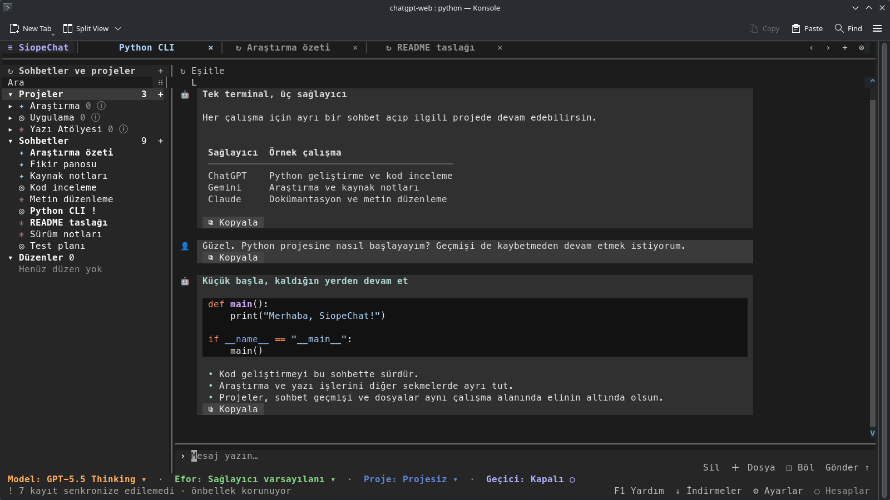

[![Версия: v1.5.2-beta][version-shield]](CHANGELOG.md)
[![Python 3.11+][python-shield]](https://www.python.org/downloads/)
[![GPL-3.0-only][license-shield]](LICENSE)

[English](README.md) | [Türkçe](README-TR.md) | **Русский**

# SiopeChat

### Веб-чаты ChatGPT, Gemini и Claude — в одном терминале.

Соберите чаты, проекты и ответы разных моделей в едином рабочем пространстве прямо в терминале. Переключайтесь между вкладками, сравнивайте ответы и продолжайте работу, не выходя из терминала.

> SiopeChat — независимый неофициальный клиент для **веб-чатов** ChatGPT, Gemini и Claude. Он использует ваш сеанс в браузере, поэтому ключ API не нужен. Доступ к моделям и лимиты определяются вашим тарифом. Клиент не подключается к официальным API для разработчиков, Codex или Claude Code. Изменения сайтов провайдеров могут повлиять на совместимость.



*Интерфейс SiopeChat в терминале с примерами чатов.*

<p align="center">
  <a href="#установка-и-вход"><strong>Установка</strong></a> &nbsp; | &nbsp;
  <a href="#работа-с-чатами"><strong>Работа с чатами</strong></a> &nbsp; | &nbsp;
  <a href="#расширения"><strong>Расширения</strong></a> &nbsp; | &nbsp;
  <a href="#разработка"><strong>Разработка</strong></a>
</p>

## Что можно делать

| Чаты | Проекты и контекст | История на устройстве |
| --- | --- | --- |
| Держите чаты во вкладках с отдельными черновиками и прокруткой; сравнивайте до четырёх панелей в группе. | Используйте проекты ChatGPT и Claude или блокноты Gemini с поддерживаемыми провайдером инструкциями и источниками. | Открывайте сохранённые беседы сразу, пока история обновляется в фоне. |
| Выбирайте модель и уровень рассуждений для аккаунта; редактируйте сообщения, запрашивайте новый ответ или создавайте ветки, если это поддерживается. | Ищите и сортируйте проекты и чаты, фильтруйте их по аккаунту провайдера. | Храните историю бесед и метаданные ресурсов в локальном архиве SQLite. |

| Файлы и загрузки | Клавиатура и расширения | Язык интерфейса |
| --- | --- | --- |
| Скачивайте созданные файлы прямо из ответов и следите за ходом загрузки. | Используйте палитру команд, настраиваемые сочетания клавиш, мышь и локальные расширения. | Выберите английский, турецкий или русский интерфейс. |

## Меньше ожидания, удобнее общение

Пишите следующее сообщение, пока SiopeChat заканчивает ответ. Общие улучшения и оптимизации отдельных провайдеров помогают сократить ненужное ожидание.

| Где заметны изменения | Что улучшено |
| --- | --- |
| **ChatGPT, Gemini и Claude** | Сохранённые чаты сразу открываются из локального архива, а история обновляется у провайдера в фоне. Подходящие каталоги моделей используются повторно, а большие истории готовятся вне цикла событий интерфейса. Когда провайдер сообщает, что генерация текста завершена, интерфейс отмечает ответ как готовый и останавливает таймер; завершающая очистка соединения может идти в фоне. Следующее сообщение можно поставить в очередь, пока завершается текущая отправка. |
| **ChatGPT** | Подходящие снимки состояния чата и сообщения, полученные из завершённых потоков, используются повторно, чтобы не запрашивать историю повторно. Заголовки Sentinel готовятся до следующей отправки. В записанном офлайн-тесте медиана генерации начального доказательства Sentinel на Python составила **0,329 мс**: этот этап занял примерно **в 10,7 раза меньше времени**, чем с повторно используемым контекстом QuickJS-NG, и **в 12,6 раза меньше**, чем в уже запущенном Node/V8 с новой VM для каждого замера. |
| **Gemini** | Исправлена маршрутизация запросов к моделям Flash; сохраняется установленная провайдером политика рассуждений по умолчанию. Корректные идентификаторы продолжения чата используются повторно, а RPC активности не повторяется в течение пяти минут. В прежних ограниченных проверках с реальным аккаунтом время до первого текста сократилось с **65–110 с до 1,89–3,80 с**. Это зафиксированные диапазоны, а не результат контролируемого теста и не гарантия для всех моделей и аккаунтов. |

**Как читать эти цифры:** коэффициенты ChatGPT сравнивают медиану локальной генерации начального доказательства, а не скорость ответа на всё сообщение. Для проверок Gemini не опубликованы парные замеры и p95, поэтому надёжный коэффициент ускорения рассчитать нельзя. Для общих улучшений интерфейса такой коэффициент тоже не измерялся. Время ответа зависит от сети, модели и нагрузки сервера. Подробности приведены ниже и в [журнале изменений](CHANGELOG.md). Версия пакета Python — `1.5.2b0`.

## Установка и вход

### Требования

Нужны Python **3.11+** и терминал с поддержкой Unicode; рекомендуется поддержка True Color и мыши. Установщики проверяют версию Python. Существующий сеанс можно импортировать из поддерживаемого профиля браузера, как описано ниже. Для обычной работы с чатами браузер не должен оставаться открытым: запросы выполняются через HTTP.

Поддерживаемые проверки ChatGPT Sentinel выполняются на Python с профилем `SentinelSpec` из пакета. **Node.js и движок JavaScript не нужны.**

<details>
<summary>Данные о скорости: что именно измерялось?</summary>

В записанном офлайн-тесте сделали 60 замеров на Linux x86_64 с Python 3.14.8 и Node.js 26.12.1. Оба варианта JavaScript использовали один и тот же SDK размером 33 820 байт. Python использовал соответствующий профиль Sentinel, не запуская SDK.

| Генерация начального доказательства | Медиана | p95 | Медиана времени / время Python |
| --- | --- | --- | --- |
| Python, повторное использование среды выполнения | 0,329 мс | 1,925 мс | 1× |
| QuickJS-NG, повторное использование контекста | 3,526 мс | 11,220 мс | 10,7× |
| QuickJS-NG, новый контекст | 8,831 мс | 17,285 мс | 26,8× |
| Node/V8, запущенный процесс, новая VM | 4,140 мс | 6,742 мс | 12,6× |
| Node/V8, новый процесс для каждой операции | 57,944 мс | 62,409 мс | 176,1× |

Последняя строка включает запуск процесса; запуск простаивающего процесса Node сам по себе занял 32,004 мс по медиане и 32,448 мс p95. Это не то же самое, что повторно использовать уже запущенный процесс. В этом тесте Node/V8 с новыми контекстами оказался быстрее QuickJS-NG, а у Python была самая низкая медиана генерации доказательства. Сетевые запросы, генерация ответа моделью и отрисовка интерфейса в замер не входят. Это прежние результаты; текущая ревизия отдельно не тестировалась.

</details>

### Установка и запуск

Один раз запустите установщик из каталога репозитория. Он проверит наличие Python 3.11+, найдёт подходящее виртуальное окружение и установит туда SiopeChat с зависимостями Python. Если подходящего окружения нет, установщик создаст каталог `python/`, не удаляя и не перезаписывая существующие каталоги.

| Платформа | Установщик |
| --- | --- |
| Терминал Linux / macOS | `./install.sh` |
| macOS Finder | `install.command` |
| Windows PowerShell | `./install.ps1` |
| Командная строка Windows | `install.bat` |

| Платформа | Запуск |
| --- | --- |
| Терминал Linux / macOS | `./siopechat.sh` |
| macOS Finder | `siopechat.command` |
| Командная строка Windows | `siopechat.bat` |
| Windows PowerShell | `./siopechat.ps1` |
| Установленная консольная команда | `siopechat` |

<details>
<summary>Виртуальное окружение и зависимости</summary>

Установщики и скрипты запуска ищут окружения в таком порядке: `python/`, `.venv/`, `venv/`, `env/`. Чтобы выбрать другой каталог, задайте `SIOPECHAT_VENV`; относительный путь считается от каталога репозитория. Установщик создаёт окружение, только если подходящего ещё нет, и не меняет существующий некорректный каталог. После обновления репозитория снова запустите установщик, чтобы установить изменившиеся зависимости. Скрипты запуска проверяют версии и напрямую запускают выбранное окружение: при каждом старте они не устанавливают пакеты и не подключаются к сети.

Для установки конечным пользователям pip использует диапазоны версий из `pyproject.toml`; устанавливать uv не требуется. `uv.lock` фиксирует точное разрешение зависимостей для CI и разработки.

</details>

### Подключение аккаунта

В новой установке список аккаунтов пуст. Добавьте или выберите аккаунт в **Настройки → Аккаунты** и нажмите **Из профиля**. Сначала войдите на сайт провайдера в последнем используемом профиле браузера по умолчанию. SiopeChat импортирует и проверяет сеанс без запуска браузера. Чаты, история, модели и проекты работают через HTTP. Если сеанс истёк, войдите снова в обычном браузере и повторите проверку.

Кнопки добавления, изменения и удаления аккаунта расположены рядом под списком аккаунтов. Изменяется только отображаемое имя выбранного аккаунта; сеанс и история сохраняются. Проверка профиля и выход находятся под сведениями о сеансе. В узком терминале подписи сокращаются.

<details>
<summary>Профили браузеров и устранение неполадок</summary>

**Из профиля** читает сеанс выбранного провайдера из последнего использованного профиля браузера по умолчанию. Браузер не запускается, флаги отладки не нужны. Сохраняются только cookie авторизации этого провайдера; новый сеанс проверяется до замены сохранённого.

Chrome, Chromium, Brave/Brave Origin, Edge и Vivaldi используют общий механизм чтения профилей Chromium. Для Safari в macOS предусмотрен отдельный механизм WebKit. Расшифровка cookie использует системное хранилище ключей с идентификаторами конкретного браузера; система может запросить разрешение на доступ.

Заблокированные базы, нестандартные или изолированные каталоги профилей и неподдерживаемое шифрование могут помешать импорту, в том числе в некоторых конфигурациях Chromium в Windows. Сообщения об ошибках различают отсутствие зависимостей, права файлов, доступ к базе, хранилищу ключей и сбои расшифровки. Неудачный импорт сохраняет прежний сеанс. Обновляйте зависимости в окружении, из которого запускается SiopeChat.

Поддерживаются сеансовые cookie из текущего файла восстановления Firefox/Zen; отдельные контейнеры и старые снимки не объединяются. Если база cookie заблокирована, чтение повторяется из приватной временной копии с файлами WAL/journal. Исходный профиль не изменяется.

Firefox и Zen используют общий механизм Gecko для чтения профилей и cookie без изменения файлов. Профиль выбирается по `profiles.ini` и `installs.ini`; неоднозначные профили не объединяются. В Linux поддерживаются каталоги Firefox Snap/Flatpak, а также текущие каталоги Zen в XDG, прежние каталоги и Flatpak. Переносные и пользовательские каталоги автоматически не определяются: назначьте нужный браузер браузером по умолчанию и используйте стандартный каталог его профиля.

</details>

### Несколько аккаунтов

Можно добавить несколько аккаунтов. Для отправки используется выбранный аккаунт каждого провайдера; просмотр истории другого аккаунта не меняет этот выбор. Чтобы проверить другой аккаунт, сначала выберите его профиль в браузере по умолчанию, затем нажмите **Из профиля** у соответствующего аккаунта SiopeChat.

Выберите аккаунт нажатием на его строку; стрелка показывает аккаунт, которым сейчас можно управлять. **Удалить аккаунт** (Alt+Backspace на экране аккаунтов) запрашивает подтверждение, затем удаляет локальную запись, сохранённый сеанс и настройки модели. Аккаунт у провайдера и архив чатов остаются. Вкладки удалённого аккаунта закрываются, устаревшие фильтры сбрасываются и выбирается другой активный аккаунт. Перед удалением последнего активного аккаунта добавьте другой.

## Работа с чатами

### Начало и навигация по беседам

Введите сообщение и нажмите **Enter**. **Shift+Enter** добавляет новую строку в терминалах с расширенной передачей клавиш, которую SiopeChat включает во время работы. Если терминал распознаёт Enter и Shift+Enter одинаково, используйте **Alt+Enter** или **Ctrl+J**. Поле ввода увеличивается до заданной высоты, после чего его содержимое можно прокручивать. Ctrl+A выделяет текст, Ctrl+C копирует выделение, Ctrl+V вставляет. Щёлкните сообщение, чтобы выделить и скопировать его содержимое.

В новом чате доступны модели выбранных аккаунтов включённых провайдеров. Строка состояния показывает общее число моделей и количество загруженных каталогов; остальные каталоги загружаются в фоне. Существующий чат сохраняет привязку к исходному аккаунту. Модели и уровни рассуждений берутся из каталога провайдера. Если провайдер сообщает об ограничениях, недоступные модели и модели другого тарифа исключаются из списка; окончательное решение всё равно остаётся за сервером. Опубликованные сводки рассуждений показываются отдельно от ответа; скрытая цепочка рассуждений недоступна.

Нажмите веб-ссылку Markdown в сообщении, чтобы открыть её в браузере по умолчанию. Нажатие в другом месте сообщения по-прежнему выделяет его для копирования.

### Действия с сообщениями и созданные файлы

Под каждым сообщением есть компактная панель действий. Копирование выполняется локально; поддерживаемые сообщения пользователя можно отредактировать и отправить повторно. Повторная генерация ответа доступна, если провайдер поддерживает её для этого сообщения. ChatGPT и Gemini также позволяют создать отдельную ветку беседы. Источники провайдера сохраняются вместе с соответствующим ответом. Сведения о модели и уровне рассуждений находятся справа, перед переключателем сохранённых версий. После редактирования или повторной генерации история обновляется после подтверждения провайдера. Кнопки удаления чата и разделения области просмотра расположены рядом с кнопкой синхронизации вверху.

Созданные файлы отображаются в ответе в виде карточек с названием, типом и размером, если эти данные доступны. Нажатие запускает фоновую загрузку; ссылки на файлы и метаданные сохраняются в архиве чата. Защищённые ресурсы доступны через аккаунт провайдера, которому принадлежит беседа. Срок хранения и доступность файла зависят от провайдера.

### Менеджер загрузок

Файлы по ссылкам загружаются в фоне в папку проекта `downloads/`. Изменить её можно в **Настройки → Общие → Папка загрузок**; относительные пути отсчитываются от каталога проекта, абсолютные также поддерживаются. Одновременно выполняются не более двух передач, прогресс отображается в строке состояния. Существующие файлы не перезаписываются, незавершённые загрузки удаляются. Обычные веб-страницы открываются в браузере по умолчанию. Ссылки на sandbox-файлы ChatGPT разрешаются по исходному чату, а ссылки-заполнители Gemini — по фактическим записям медиа. Ссылки Claude sandbox/computer загружаются из хранилища файлов исходного чата. Защищённые файлы загружаются с сохранённым сеансом выбранного аккаунта; данные авторизации не пересылаются на другие домены. Если ресурс отсутствует или срок его действия истёк, показывается ошибка.

Откройте страницу **Загрузки** между справкой и настройками, введите `/downloads` или нажмите **Alt+J**. На странице показаны загруженный объём, общий и оставшийся объём (если известны), состояние передачи и исходный чат. Группы по датам можно сворачивать; поиск охватывает имена файлов, названия чатов и аккаунты. Доступны фильтр по состоянию и сортировка по дате, имени и размеру. **Обновить** проверяет наличие файлов в фоне; такая проверка также выполняется каждые десять секунд. Удалённый файл остаётся в истории с отметкой **Удалено**, а удалённый исходный чат отмечается отдельно. **Удалить файл** сохраняет запись в истории; **Убрать запись** оставляет файл на диске. Расширение архива сохраняет новые записи о загрузках в SQLite между запусками; при отключённом архиве история хранится только до выхода из приложения. Незавершённые к моменту выхода передачи помечаются как **Прервано**. Для файлов, загруженных до появления этой функции, запись об исходном чате автоматически не создаётся.

По умолчанию размер файла ограничен 512 МиБ. В общих настройках можно задать предел в байтах и разрешить загрузки из локальной сети. При загрузке из интернета блокируются частные IP-адреса и адреса обратной петли, проверяется каждый редирект и запрещается переход с HTTPS на HTTP. Соединение устанавливается с проверенным IP-адресом, а исходное имя узла сохраняется для TLS и HTTP.

### Клавиатура, выделение и фоновые ответы

Выделите мышью часть ответа или сводки рассуждений и нажмите Ctrl+C. Чтобы выбрать всё сообщение, нажмите на него, затем Ctrl+A.

Закрытие вкладки не прерывает текущий ответ. В боковом списке зелёный **●** обозначает чат с выполняющимся ответом, а **✓** — завершённый ответ, полученный в фоне. Выберите чат, чтобы снова его открыть. Пока формируется ответ, можно переходить к другим чатам и синхронизировать историю. Обработка продолжается, только пока запущен SiopeChat.

| Сочетание по умолчанию | Действие |
| --- | --- |
| F1 | Открыть / закрыть справку |
| Ctrl+P | Палитра команд |
| Ctrl+T / Ctrl+W | Новая вкладка / закрыть вкладку |
| Alt+Left / Alt+Right | Предыдущая / следующая вкладка |
| Alt+[ / Alt+] | Предыдущая / следующая панель группы |
| Alt+W | Закрыть все вкладки без активных операций |
| F7 | Показать / скрыть боковую панель |
| F8 / F10 | Синхронизировать чат / библиотеку |
| F5 / F12 | Настройки / аккаунты |

Изменения сочетаний сразу действуют во всём интерфейсе. Все сочетания меняются в разделе **Настройки → Сочетания клавиш** или в локальном `config.json`. Палитра команд предоставляет те же действия, включая действия расширений.

Настройки открываются как обычная вкладка: Alt+Left/Right переключает между ней и чатами, F5 открывает уже существующую вкладку настроек, Ctrl+W закрывает её.

### Проекты и разделённый вид

С помощью `/project` выберите проект для нового чата или переместите туда текущий чат, если провайдер это поддерживает. Вариант **Без проекта** удаляет привязку. `/project-new` сначала запрашивает провайдера и аккаунт, затем показывает доступные поля создания. В сведениях проекта можно изменить название, инструкции и источники; Ctrl+S сохраняет встроенную форму.

На странице проекта можно сразу начать беседу. Выберите модель и уровень рассуждений для аккаунта проекта и отправьте сообщение: откроется отдельная вкладка чата в этом проекте. Пока вы редактируете сам проект, поле сообщения и элементы выбора скрыты.

Выберите **Разделить**, `/split` или `/split-down`, затем откройте другой чат из боковой панели. Щелчок по неактивной панели делает её активной. Прокрутка пассивной панели колёсиком не меняет фокус. `/unsplit` возвращает одинарный вид. Действие `layout.create` в палитре команд сохраняет открытые чаты, направление разделения и активную панель. Откройте сохранённое рабочее пространство в боковой панели, чтобы восстановить раскладку. Сохраняются только ссылки на беседы; временные чаты, черновики и выполняющиеся запросы не включаются.

Чтобы удалить чат, используйте **Удалить** рядом с полем сообщения. `/project-delete` открывает список проектов; кнопка удаления есть и в сведениях о проекте. В обоих случаях требуется подтверждение безвозвратного удаления; по умолчанию выбрано **Нет**. Сначала провайдер получает запрос на удаление и подтверждает его, затем удаляются локальные записи. Удаление чатов внутри проекта зависит от правил провайдера. Закрытие вкладки не удаляет чат.

### Различия провайдеров

| Провайдер | Проекты | Текущие ограничения |
| --- | --- | --- |
| ChatGPT | Проекты, инструкции, источники и поддерживаемые перемещения чатов | Модели, уровни рассуждений, временный режим и параметры проектов зависят от аккаунта. |
| Gemini | Блокноты Gemini как отдельный тип проекта; чаты с контекстом блокнота, инструкции и текстовые источники | Существующий чат нельзя переместить в блокнот. Импорт источников из файлов и URL недоступен. Уровни рассуждений и настройки по умолчанию определяются веб-каталогом аккаунта. |
| Claude | Проекты, инструкции, текстовые и файловые источники, поддерживаемые перемещения чатов | Временные чаты доступны вне проектов. Дополнительные параметры приватности и памяти, кроме private/default, не предоставляются. |

Блокноты Gemini используют ваш сеанс Gemini; отдельный вход в NotebookLM не требуется. Типы проектов и метаданные источников хранятся отдельно для каждого провайдера. Доступные функции зависят от провайдера и аккаунта.

Локальный лимит вложения — **20 МиБ** на файл; провайдер может установить меньший предел. Временный режим доступен, только если его поддерживает провайдер, и не сохраняет локальные снимки чата. Применяются правила хранения данных провайдера.

## Настройки и локальные данные

### Настройки и конфиденциальность

`config.json` создаётся локально и исключён из Git. Значения по умолчанию заданы в `src/settings.py`. Язык выбирается в **Настройки → Общие → Язык** (`en`, `tr`, `ru`), провайдеры — в разделе **Провайдеры**, расширения — в разделе **Расширения**. Хотя бы один провайдер должен оставаться включённым.

Переменная `SIOPECHAT_HOME` задаёт другую директорию конфигурации и данных. Не публикуйте конфигурацию, сеансы аккаунтов и `data/`; не прикладывайте их к сообщениям об ошибках.

### Архив и хранение файлов

Расширение архива хранит в `data/archive.sqlite3` чаты, упорядоченные сообщения, опубликованные сводки рассуждений, проекты и блокноты, связи чатов с проектами и метаданные ресурсов. Загруженные пользователем файлы в архив не копируются: сохраняются только идентификаторы провайдера и доступные метаданные, без локального пути и содержимого. При обновлении старого архива прежние копии файлов, названные по содержимому, удаляются; история и метаданные остаются. Скачанные файлы хранятся в выбранной папке, а архив сохраняет только записи о загрузках. Внешние изображения и источники остаются ссылками; сами файлы автоматически не скачиваются.

**Примечание об обновлении:** Миграция схемы v5 безвозвратно удаляет старые копии загруженных файлов. Перед первым запуском с архивом старой версии сохраните и `data/archive.sqlite3`, и каталог `data/files/`, если локальные копии нужны для работы без сети или вы можете вернуться на прежнюю версию SiopeChat. При использовании собственного `SIOPECHAT_HOME` скорректируйте пути относительно каталога данных.

### Загрузка, память и синхронизация

Сохранённые чаты сначала открываются из архива, а затем обновляются у провайдера в фоне. Пока загружается история, можно писать и отправлять сообщения. Старые сообщения объединяются с новыми локальными данными, не перезаписывая текущий ответ. Кэшированные страницы боковой панели и проектов остаются доступны во время обновления; при ошибке сохраняются последние корректные данные.

Большие истории готовятся вне цикла событий интерфейса, а боковая панель рисует только видимые строки. Очереди архива и кэши отрисовки ограничены. Отключение архива сохраняет его файлы и не мешает прямой работе с провайдером. Отключение расширения компоновки убирает разделение панелей, не отключая провайдеров.

<details>
<summary>Постраничная загрузка истории и ограничения памяти</summary>

Первое чтение SQLite возвращает до 80 видимых сообщений, пока суммарный объём сериализованных записей не превышает 262 144 символа. При прокрутке добавляются предыдущие фрагменты истории; уже загруженные сообщения остаются. Положение сохраняется по постоянному идентификатору сообщения. Отдельное сообщение не обрезается ради ограничения размера фрагмента.

Сначала подготавливается видимая область, затем по два экрана выше и ниже неё. Для строк каждого представления используется LRU-кэш на 1 МиБ и отдельный ANSI-кэш на 256 КиБ, который сжимает крупные записи. Неактивные основные вкладки делят общий лимит в 4 МиБ. Текст по возможности повторно используется вместе с данными разметки; принятые ответы обновляют только ограниченный хвост истории SQL.

При закрытии вкладки освобождаются ссылки на историю и данные отрисовки; сообщения текущего фонового ответа сохраняются до завершения записи. Объём данных истории растёт по мере её просмотра, а кэши отрисовки остаются ограниченными. Python может удерживать освобождённую память для повторного использования, поэтому RSS процесса не обязательно сразу уменьшается.

</details>

Если результат удалённой операции записи неизвестен, синхронизируйте чат перед повторной отправкой. SiopeChat не повторяет автоматически операцию, которая уже могла дойти до провайдера.


## Расширения

Создайте `extensions/my_feature/plugin.py`. Экспортируйте `ExtensionSpec` с функцией активации, которая регистрирует возможности через общий API:

```python
from extension import Action, ExtensionSpec, SettingField


def activate(context):
    context.settings(SettingField("enabled", bool, True, "my_feature.enabled"))
    context.translations("en", {"enabled": "Enable my feature"})
    context.translations("tr", {"enabled": "Özelliğimi etkinleştir"})
    context.translations("ru", {"enabled": "Включить расширение"})
    context.action(Action("my_feature.hello", "Hello", lambda: "Hello"))


SPEC = ExtensionSpec("my_feature", activate, api_version=3)
```

В каталоге каждого расширения рядом с `plugin.py` должен находиться `manifest.json`. Он описывает расширение без запуска Python-кода:

```json
{"id": "my_feature", "api_version": 3, "requires": []}
```

Значение `requires` должно совпадать со списком зависимостей в `ExtensionSpec`. Отключённые расширения не импортируются; их модуль загружается только при включении. В манифесте и `ExtensionSpec` должна быть указана одна версия API.

Регистрируйте сервисы расширения через `context.provide()`, а остальные ресурсы освобождайте через `context.on_dispose()`.

Перезапустите приложение, чтобы оно обнаружило пакет, затем включайте и отключайте расширение в **Настройки → Расширения**. Его настройки хранятся в `extensions.my_feature`. Переводы используют пространство имён расширения и добавляются в общий каталог приложения. При необходимости укажите зависимость `requires=("archive",)`. Действия могут объявлять поля ввода для палитры команд; расширения также регистрируют сервисы и представления.

Архив доступен через `context.api.get("archive")`. Методы `conversations`, `messages` и `resources` возвращают страницы записей в рамках провайдера и аккаунта. Интерфейс репозитория и его реализация для SQLite находятся в `extensions/archive/repository.py`, нормализация данных провайдеров — в `adapters.py`.

Расширения выполняют локальный код. Загружайте только доверенные пакеты. Не выполняйте сетевые операции в функциях отрисовки; освобождайте ресурсы через общий жизненный цикл.

Записи архива возвращаются в постоянном порядке по удалённым идентификаторам; сортировка интерфейса применяется отдельно. `siopechat action archive.inspect` сообщает об отсутствующих ссылках и файлах без записей, которые на них ссылаются. `siopechat action archive.collect` сначала показывает предварительный список очистки; чтобы удалить найденные файлы, передайте аргумент действия `'{"dry_run": false}'`. Файлы с несколькими ссылками, неизвестные файлы и содержимое, сохранённое за последний час, защищены. База с более новой версией схемы отклоняется без изменений.

## Разработка

### Подготовка окружения и проверки

Для разработки приложения используйте Python 3.11+. Установите [uv](https://docs.astral.sh/uv/) и выполните команды из корня репозитория. Используйте имеющееся окружение проекта `python/`, чтобы разработка и скрипты запуска работали с одним набором зависимостей:

```sh
# Linux / macOS
UV_PROJECT_ENVIRONMENT=python uv sync --locked --all-groups
python/bin/python run_tests.py
python/bin/python -m ruff check .
python/bin/python -m ruff format --check .
python/bin/python -m build
python/bin/python -m twine check dist/*
```

В Windows PowerShell сначала задайте `$env:UV_PROJECT_ENVIRONMENT = "python"`, затем выполните `uv sync --locked --all-groups`. В остальных командах замените `python/bin/python` на `./python/Scripts/python.exe`.

`run_tests.py` запускает тесты приложения, изолированную копию тестов провайдеров и базовую проверку пакета провайдеров. Тесты используют имитации клиентов и подготовленные данные; личные сеансы аккаунтов не нужны. Сначала скрипт выбирает активное виртуальное окружение, затем окружения проекта (`python/`, потом `.venv/`), uv и, наконец, интерпретатор, которым был запущен. Чтобы выбрать нужную версию Python без неоднозначности, запускайте скрипт непосредственно через этот интерпретатор.

Проверка кода, форматирования и сборка дистрибутивов выполняются отдельно. GitHub Actions проверяет приложение на Linux, Windows и macOS с Python 3.11 и 3.14, а пакет провайдеров — отдельно с Python 3.10 и 3.14. Успешные офлайн-тесты сами по себе не подтверждают совместимость с работающими сервисами или поведение в реальном терминале.

### Где искать код

| Расположение | Назначение |
| --- | --- |
| `src/bootstrap.py`, `src/cli.py` | Инициализация приложения и точки входа командной строки |
| `src/accounts.py`, `src/tasks.py`, `src/runtime.py` | Маршрутизация аккаунтов, управление задачами и жизненным циклом сервисов |
| `src/providers/` | Независимые клиенты веб-сеансов, транспорт и контракты провайдеров |
| `src/tui/` | Терминальные представления, обработка ввода и отрисовка |
| `src/extension.py`, `src/tui/api.py` | Жизненный цикл расширений и открытый API терминального интерфейса |
| `extensions/archive/`, `extensions/layout/` | Локальная история и сохранённые рабочие пространства |
| `tests/`, `src/providers/tests/` | Регрессионные тесты приложения и независимые тесты провайдеров |

Детали протокола следует хранить в коде соответствующего провайдера. Код провайдеров не должен импортировать базу данных приложения, настройки, расширения или TUI. Расширения регистрируют сервисы через `extension.py`, а для элементов интерфейса используют `tui.api`. Сетевые запросы и затратную обработку Markdown выполняйте вне функций отрисовки.

`TaskService` выполняет отправки по очереди для каждого аккаунта. При отмене аккаунт освобождается после закрытия транспорта и сохранения уже принятого ответа. Закрытие вкладки не останавливает ответ: он продолжает обрабатываться в фоне, пока приложение запущено. Изменения должны сохранять идентификаторы провайдера и аккаунта, связи сообщений с родительскими сообщениями, ветвление и поведение отмены. Операции записи с неопределённым результатом нельзя автоматически отправлять повторно.

### Независимое использование провайдеров

Установите пакет в выбранное окружение командой `python -m pip install ./src/providers`. `ProviderClient` управляет адаптерами аккаунтов, потоками и закрытием соединений. `Backend` предоставляет доступ к моделям, чатам, проектам и источникам, а также загрузку файлов и получение ссылок для скачивания. Приложение использует ту же фабрику `create_provider`. Примеры и независимые тесты приведены в [руководстве по провайдерам](src/providers/README.md).

Транспорт, поиск профилей браузера и доступ к локальному CDP реализованы на Python. Gemini использует HTTPS-транспорт пакета, отдельный Gemini SDK не требуется. Поддерживаемые проверки ChatGPT Sentinel выполняются в Python с профилем из пакета. Изменившиеся или неподдерживаемые требования сервера необходимо отдельно проверять на совместимость: офлайн-тесты не охватывают все проверки реальных сервисов.

### Устройство локального хранилища

| Файл | Содержимое |
| --- | --- |
| `config.json` | Настройки, названия и выбор аккаунтов |
| `data/accounts.sqlite3` | Сеансы аккаунтов, каталоги моделей, результаты проверки и резервный кэш чатов |
| `data/archive.sqlite3` | История, метаданные ресурсов, записи загрузок и локальные версии ответов |
| `data/workspaces.sqlite3` | Сохранённые расположения чатов |

Пути указаны относительно настроенного каталога приложения. Поля отдельных провайдеров хранятся в формате JSON в соответствующей базе. Библиотека провайдеров использует переданное вызывающей стороной хранилище учётных данных и не зависит от схем SQLite приложения. База аккаунтов не зашифрована; в Unix доступ к ней ограничен владельцем файла. Выполняйте миграции в транзакциях и сохраняйте пользовательские данные. Перед открытием старого архива прочитайте предупреждение об обновлении выше.

### Измерение производительности и отчёты об ошибках

Чтобы измерить этапы отправки ChatGPT, задайте `SIOPECHAT_SEND_TIMINGS=1` перед запуском приложения. Сравнивайте один и тот же аккаунт, модель, уровень рассуждений, состояние чата и условия сети. Отдельно учитывайте установку соединения, получение первого текста от провайдера, появление первого текста в интерфейсе и завершение обработки; указывайте число замеров, медиану и p95. Не записывайте в диагностические журналы данные сеансов, тексты сообщений или содержимое токенов.

В отчёте об ошибке укажите версию, провайдера, операцию, терминал, ОС и текст ошибки без конфиденциальных данных. Уточните, возникла ли проблема в офлайн-тесте или в реальном сеансе. История изменений версий находится в [CHANGELOG.md](CHANGELOG.md).

## Лицензия

Авторское право © TahsinCr. Лицензия — [GPL-3.0-only](LICENSE). Уведомления сторонних компонентов сохранены в `src/utils/`.

[version-shield]: https://img.shields.io/badge/version-v1.5.2--beta-b7a3e3.svg?style=for-the-badge
[python-shield]: https://img.shields.io/badge/Python-3.11%2B-3776AB.svg?style=for-the-badge&logo=python&logoColor=white
[license-shield]: https://img.shields.io/badge/license-GPL--3.0--only-blue.svg?style=for-the-badge
