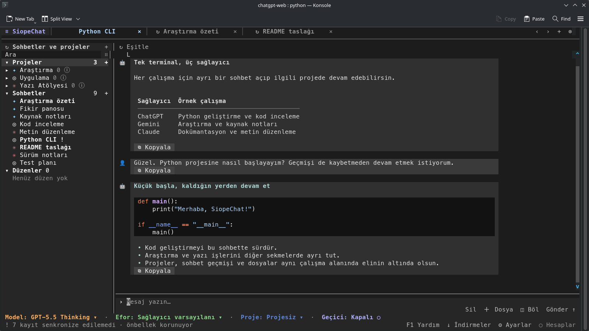

[![Версия: v1.5.6-beta][version-shield]](CHANGELOG.md)
[![Python 3.10+][python-shield]](https://www.python.org/downloads/)
[![GPL-3.0-only][license-shield]](LICENSE)

[English](README.md) | [Türkçe](README-TR.md) | **Русский**

# SiopeChat

**Веб-чаты ChatGPT, Gemini, Claude и Grok в одном терминале.**

Держите чаты и проекты под рукой, а когда нужно сравнить ответы, откройте их рядом.

> SiopeChat — независимый клиент для веб-чатов. Он использует действующий сеанс браузера и не требует ключа API. Приложение не подключается к официальным API для разработчиков и не запускает агентов для работы с кодом, таких как Codex, Claude Code или Google Antigravity CLI. Доступ к моделям и лимиты определяются вашим аккаунтом.

[Установка](#установка) · [Подключение аккаунта](#подключение-аккаунта) · [Сравнение провайдеров](#возможности-провайдеров) · [Производительность](#производительность) · [История изменений](CHANGELOG.md)



*Интерфейс SiopeChat в терминале с примерами чатов.*

## Установка

Понадобятся Git, Python 3.10 или новее и терминал с поддержкой Unicode.

**Linux / macOS**

```sh
git clone https://github.com/TahsinCr/siopechat.git
cd siopechat
./install.sh
./siopechat.sh
```

**Windows (PowerShell)**

```powershell
git clone https://github.com/TahsinCr/siopechat.git
cd siopechat
.\install.ps1
.\siopechat.ps1
```

Достаточно запустить установщик один раз. Для обычного запуска используйте второй скрипт. Чтобы обновить рабочую копию, выполните `git pull --ff-only` и повторно запустите установщик для своей системы.

## Подключение аккаунта

1. Войдите в аккаунт провайдера в последнем использованном профиле браузера по умолчанию.
2. В SiopeChat откройте **Настройки → Аккаунты** и добавьте или выберите нужный аккаунт.
3. Нажмите **Из профиля**, чтобы импортировать и проверить сеанс. Если срок действия сеанса истёк, снова войдите в аккаунт в браузере и повторите этот шаг.

## Возможности

- **Вкладки и панели.** Переключайтесь между чатами, сохраняя черновики и положение прокрутки. Открывайте до четырёх чатов рядом и сохраняйте их расположение как рабочее пространство.
- **Аккаунты и модели.** Переключайтесь между аккаунтами и выбирайте доступные им модели. Настраивайте уровень рассуждений там, где его можно менять.
- **Ответы в реальном времени.** Читайте ответ по мере поступления и продолжайте работу в другой вкладке. Если провайдер поддерживает, редактируйте сообщения, запрашивайте новый ответ или создавайте ветку чата.
- **Проекты и блокноты.** Работайте с проектами ChatGPT и Claude, блокнотами Gemini и рабочими пространствами Grok. Добавляйте инструкции и источники и переносите чаты, если это позволяет провайдер.
- **История и загрузки.** Возвращайтесь к чатам из архива, экспортируйте переписку в текст или JSON и следите за загрузкой созданных файлов.

## Возможности провайдеров

| В SiopeChat | ChatGPT | Gemini | Claude | Grok |
| --- | --- | --- | --- | --- |
| Потоковые ответы, история чатов и выбор модели | Да | Да | Да | Да |
| Выбор уровня рассуждений | Поддерживаемые модели | Поддерживаемые модели | Поддерживаемые модели | — |
| Редактирование сообщений и повтор ответа | Да | Да | Да | Да |
| Ветвление чата | Да | Да | — | — |
| Временные чаты или режим инкогнито | Да | Да | Вне проектов | Вне рабочих пространств |
| Проекты | Проекты | Блокноты Gemini | Проекты | Рабочие пространства |
| Инструкции, текстовые и файловые источники проекта | Да | Да | Да | Да |
| Перенос существующего чата в проект | Да | — | Да | Да |
| Вложения в чате | Да | Да | Да | Да |

Таблица описывает возможности, доступные через SiopeChat. Доступ к моделям, возможность редактирования сообщения и типы вложений зависят от провайдера, аккаунта и чата. Прочерк означает, что SiopeChat не предлагает эту функцию для данного провайдера.

## Производительность

Сохранённый чат открывается из локального архива, а свежая история загружается в фоне. Как только приходит первый текст ответа, он появляется в терминале. Дальнейшие обновления выводятся группами, чтобы прокрутка и переключение вкладок оставались плавными.

[WebAI Provider 2.0](https://pypi.org/project/webai-provider/2.0.0/) управляет веб-сеансами и передаёт ответы по мере их поступления. Движок использует уже открытые соединения, актуальный список моделей и сохранённый контекст разговора, когда это возможно. Пока вы пишете сообщение, SiopeChat может заранее подготовить следующий запрос. Это сокращает работу на стороне приложения. Когда модель начнёт отвечать, по-прежнему зависит от провайдера и сети.

## Основные сочетания клавиш

| Сочетание | Действие |
| --- | --- |
| **Ctrl+P** | Открыть палитру команд |
| **Ctrl+T / Ctrl+W** | Открыть или закрыть вкладку |
| **Alt+← / Alt+→** | Переключить вкладку |
| **Alt+J** | Открыть загрузки |
| **F5 / F12** | Открыть настройки или аккаунты |
| **F1** | Открыть справку по клавишам |

Английский, турецкий и русский языки доступны в разделе **Настройки → Общие → Язык**. Назначения клавиш можно изменить в разделе **Настройки → Сочетания клавиш**.

## Локальные данные

SiopeChat хранит историю и сведения об источниках в локальном архиве SQLite. Скрипты репозитория по умолчанию сохраняют данные рядом с рабочей копией. Чтобы использовать пользовательские каталоги операционной системы, задайте `SIOPECHAT_PORTABLE=0` перед запуском. Папку загрузок можно выбрать в настройках. Поддерживаемые временные чаты не сохраняются в локальном архиве. Правила хранения данных у провайдера остаются в силе.

Перед обновлением со старой версии сохраните копию `archive.sqlite3` и каталога `files/`, если он есть.

## Ссылки

[История изменений](CHANGELOG.md) · [Сообщить об ошибке](https://github.com/TahsinCr/siopechat/issues) · [WebAI Provider](https://github.com/TahsinCr/webai-provider/) · [GPL-3.0-only](LICENSE) · [Авторские права](COPYRIGHT)

[version-shield]: https://img.shields.io/badge/version-v1.5.6--beta-b7a3e3.svg?style=for-the-badge
[python-shield]: https://img.shields.io/badge/Python-3.10%2B-3776AB.svg?style=for-the-badge&logo=python&logoColor=white
[license-shield]: https://img.shields.io/badge/license-GPL--3.0--only-blue.svg?style=for-the-badge
