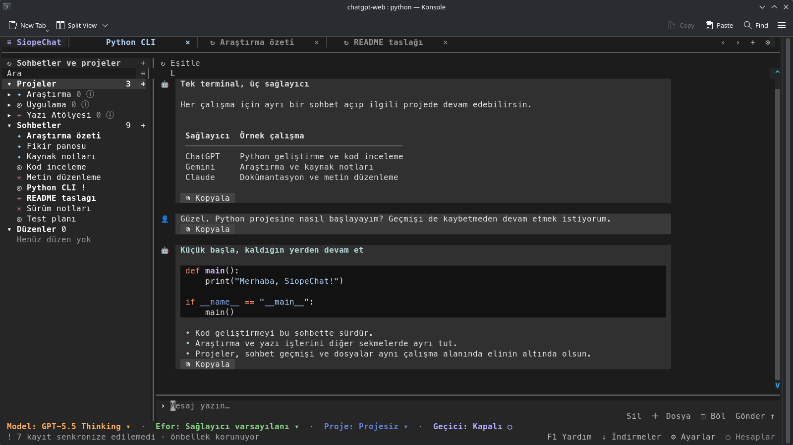

[![Sürüm: v1.5.3-beta][version-shield]](CHANGELOG.md)
[![Python 3.11+][python-shield]](https://www.python.org/downloads/)
[![GPL-3.0-only][license-shield]](LICENSE)

[English](README.md) | **Türkçe** | [Русский](README-RU.md)

# SiopeChat

### ChatGPT, Gemini ve Claude web sohbetleri — tek terminalde.

Sohbetlerinizi, projelerinizi ve farklı modellerin yanıtlarını tek bir terminal çalışma alanında toplayın. Sekmeler arasında geçin, yanıtları yan yana karşılaştırın ve terminalden ayrılmadan çalışmayı sürdürün.

> SiopeChat; ChatGPT, Gemini ve Claude’un **web sohbetleri** için geliştirilmiş bağımsız, resmî olmayan bir istemcidir. Tarayıcıdaki oturumunuzu kullanır; API anahtarı gerektirmez. Aboneliğinizin model erişimi ve kullanım sınırları geçerlidir. Resmî geliştirici API’lerine, Codex’e veya Claude Code’a bağlanmaz. Sağlayıcı sitelerindeki değişiklikler uyumluluğu etkileyebilir.



*Örnek sohbet verileriyle çalışan gerçek SiopeChat terminal arayüzü.*

<p align="center">
  <a href="#kurulum-ve-giriş"><strong>Kurulum</strong></a> &nbsp; | &nbsp;
  <a href="#kullanım"><strong>Kullanım</strong></a> &nbsp; | &nbsp;
  <a href="#eklenti-geliştirme"><strong>Eklentiler</strong></a> &nbsp; | &nbsp;
  <a href="#geliştirme"><strong>Geliştirme</strong></a>
</p>

## Neler yapabilirsiniz?

| Sohbetler | Projeler ve bağlam | Yerel geçmiş |
| --- | --- | --- |
| Taslak ve kaydırma konumlarını koruyan sekmeler kullanın; bir grupta en fazla dört paneli karşılaştırın. | ChatGPT ve Claude projeleri ya da Gemini defterleriyle çalışın; sağlayıcının desteklediği talimat ve kaynakları yönetin. | Kayıtlı sohbetleri hemen açın, geçmişi arka planda eşitleyin. |
| Hesaba göre model ve düşünme eforu seçin; desteklenen mesajları düzenleyin, yanıtı yeniden üretin veya sohbeti dallandırın. | Proje ve sohbetleri arayın, sıralayın ve sağlayıcı hesabına göre filtreleyin. | Sohbet geçmişini ve kaynak bilgilerini yerel SQLite arşivinde tutun. |

| Dosyalar ve indirmeler | Kısayollar ve eklentiler | Diliniz |
| --- | --- | --- |
| Yanıtlarda üretilen dosyaları indirin; ilerlemeyi indirme yöneticisinde izleyin. | Komut paleti, değiştirilebilir kısayollar, fare kontrolleri ve yerel eklentileri kullanın. | İngilizce, Türkçe veya Rusça arayüzü seçin. |

> **v1.5.3-beta**, kayıtlı sohbetleri ve önbellekteki model kataloglarını daha erken gösterirken sağlayıcı geçmişini arka planda eşitler. Metin üretimi biter bitmez yanıt tamamlanmış gösterilir ve sonraki mesaj kuyruğa alınabilir; geçmiş yükleme ve temizlik işleri arayüzü bekletmez. Sağlayıcı isteklerinin yeniden kullanımı, klavye gezintisi, yeniden deneme ve hesap aksiyonları, bölünmüş görünümde geçmiş ve indirme güvenliği de iyileştirildi.

## Daha Akıcı Sohbet

| Kapsam | Neler iyileşti? |
| --- | --- |
| **ChatGPT, Gemini ve Claude** | Kayıtlı sohbetler yerel arşivden açılır; sağlayıcı geçmişi arka planda eşitlenir. Geçerli model katalogları önbellekten kullanılır, büyük geçmişler ise arayüz olay döngüsünün dışında hazırlanır. Sağlayıcı metin üretiminin tamamlandığını bildirdiğinde yanıt tamamlanmış gösterilir ve süre sayacı durur; bağlantının kapanış işlemleri arka planda sürebilir. Mevcut gönderim tamamlanırken sonraki mesajı kuyruğa alabilirsiniz. |
| **ChatGPT** | Uygun sohbet anlık görüntüleri ve tamamlanan akışlardan alınmış mesajlar yeniden kullanılarak yinelenen geçmiş istekleri azaltılır. Sentinel başlıkları sonraki gönderimden önce hazırlanır. Kayıtlı çevrimdışı ölçümde Sentinel başlangıç kanıtı üretiminin saf Python medyanı **0,329 ms** oldu: bu aşama, yeniden kullanılan QuickJS-NG bağlamından yaklaşık **10,7 kat**, açık Node/V8 sürecinde her örnek için yeni VM oluşturan yoldan **12,6 kat daha kısa** sürdü. |
| **Gemini** | Flash modelleri için istek yönlendirmesi düzeltildi; sağlayıcının varsayılan düşünme politikası korunuyor. Geçerli sohbet devam kimlikleri yeniden kullanılıyor ve etkinlik RPC çağrısı beş dakika içinde yinelenmiyor. Önceki sınırlı canlı denemelerde ilk metne ulaşma süresinin **65–110 saniye aralığından 1,89–3,80 saniye aralığına** düştüğü kaydedildi. Bunlar kontrollü benchmark sonuçları değil, kayıtlı süre aralıklarıdır; her model ve hesap için garanti edilmez. |

**Rakamlar hakkında:** ChatGPT süreleri tam yanıtı değil, yerel kanıt üretimini ölçer. Gemini değerleri eşleştirilmiş örnek ve p95 içermeyen sınırlı canlı gözlemlerdir; ortak arayüz iyileştirmeleri için ölçülmüş bir katsayı yoktur. Sonuçlar ağ, model ve sunucu yüküne göre değişir. Ayrıntılar [değişiklik günlüğünde](CHANGELOG.md). Python paket sürümü: `1.5.3b0`.

## Kurulum ve giriş

### Gereksinimler

Python **3.11+** ve Unicode destekli bir terminal gerekir; gerçek renk ve fare desteği önerilir. Kurulum araçları Python sürümünü denetler. Aşağıda anlatıldığı gibi, mevcut oturumunuzu desteklenen bir tarayıcı profilinden aktarabilirsiniz. Günlük sohbet işlemleri HTTP üzerinden yürür; tarayıcının açık kalması gerekmez.

ChatGPT’nin desteklenen Sentinel kontrolleri, paketteki `SentinelSpec` profiliyle Python’da çalışır. **Node.js veya JavaScript motoru gerekmez.**

<details>
<summary>Performans verileri: tam olarak ne ölçüldü?</summary>

Kayıtlı çevrimdışı benchmark, Linux x86_64 üzerinde Python 3.14.8 ve Node.js 26.12.1 ile 60 örnek üzerinden yapıldı. İki JavaScript uygulaması da aynı 33.820 baytlık SDK’yı kullandı. Python uygulaması ise SDK’yı çalıştırmak yerine karşılık gelen Sentinel profilini kullandı.

| Başlangıç kanıtı üretimi | Medyan | p95 | Medyan süre / Python süresi |
| --- | --- | --- | --- |
| Saf Python, yeniden kullanılan çalışma zamanı | 0,329 ms | 1,925 ms | 1× |
| QuickJS-NG, yeniden kullanılan bağlam | 3,526 ms | 11,220 ms | 10,7× |
| QuickJS-NG, yeni bağlam | 8,831 ms | 17,285 ms | 26,8× |
| Node/V8, açık süreç ve yeni VM | 4,140 ms | 6,742 ms | 12,6× |
| Node/V8, her işlemde yeni süreç | 57,944 ms | 62,409 ms | 176,1× |

Son satır süreç başlatma maliyetini de içerir; boşta bir Node sürecini başlatmak tek başına 32,004 ms medyan / 32,448 ms p95 sürdü. Bu, açık bir süreci yeniden kullanmakla eşdeğer değildir. Bu ölçümde yeni bağlamlarla Node/V8, QuickJS-NG’den hızlıydı; başlangıç kanıtı üretiminde en düşük medyan Python’da ölçüldü. Ağ istekleri, modelin yanıt üretimi ve arayüz çizimi bu ölçüme dahil değildir. Bunlar geçmiş ölçümlerdir; mevcut revizyonda tekrarlanmadı.

</details>

### Kurulum ve başlatma

Komutları depo dizininde çalıştırın. Linux ve macOS aynı komutları kullanır. Kurulumu bir kez yapın; SiopeChat'i her açışınızda başlatma komutunu çalıştırın.

**Linux / macOS**

```sh
./install.sh
./siopechat.sh
```

**Windows (PowerShell)**

```powershell
.\install.ps1
.\siopechat.ps1
```

Kurulum aracı Python 3.11+ sürümünü denetler, uyumlu bir sanal ortamı kullanır veya `python/` dizinini oluşturur ve bağımlılıkları kurar.

<details>
<summary>Sanal ortam ve bağımlılık ayrıntıları</summary>

Kurulum ve başlatma araçları ortamları şu sırayla arar: `python/`, `.venv/`, `venv/`, `env/`. Başka bir ortam kullanmak için `SIOPECHAT_VENV` değişkenine ortam dizinini yazın; göreli yollar depo dizinine göre çözülür. Yalnızca kurulum aracı, uygun ortam bulunmadığında yenisini oluşturur. Mevcut ancak bozuk veya uyumsuz dizinlere dokunulmaz. Depoyu güncelledikten sonra değişen bağımlılıkları kurmak için kurulum aracını yeniden çalıştırın. Başlatıcılar her açılışta paket kurmaz veya ağa bağlanmaz; gerekli sürümleri denetleyip seçilen ortamı başlatır.

Son kullanıcı kurulumu `pyproject.toml` içindeki sürüm aralıklarını pip ile kullanır; uv yüklemek gerekmez. `uv.lock`, CI ve geliştirme ortamlarında tam bağımlılık çözümünü sabitlemeye devam eder.

</details>

### Hesap bağlama

Yeni kurulumlarda hesap listesi boştur. **Ayarlar → Hesaplar** bölümünden hesap ekleyin veya seçin, ardından **Profil ile doğrula** seçeneğini kullanın. Önce varsayılan tarayıcınızda en son kullandığınız profile geçip sağlayıcıya giriş yapın. SiopeChat tarayıcıyı açmadan oturumu aktarır ve doğrular. Sohbet, geçmiş, model ve proje işlemleri HTTP üzerinden yürür. Oturumun süresi dolarsa normal tarayıcınızda yeniden giriş yapıp doğrulamayı tekrarlayın.

Hesap ekleme, düzenleme ve kaldırma düğmeleri listenin altında yan yana bulunur. Düzenleme yalnızca seçili hesabın görünen adını değiştirir; oturumu ve geçmişi korunur. Profil doğrulama ve oturum kapatma düğmeleri oturum bilgilerinin altındaki ayrı bir sıradadır. Dar terminallerde düğme adları kısalır.

<details>
<summary>Desteklenen tarayıcı profilleri ve sorun giderme</summary>

**Profil ile doğrula**, varsayılan tarayıcınızda en son kullanılan profilden seçili sağlayıcının oturumunu okur. Tarayıcıyı başlatmaz ve hata ayıklama bayrağı gerektirmez. Yalnızca ilgili sağlayıcının kimlik doğrulama çerezleri alınır; yeni oturum kayıtlı oturumun yerini almadan önce doğrulanır.

Chrome, Chromium, Brave/Brave Origin, Edge ve Vivaldi aynı Chromium profil okuyucusunu kullanır. Firefox ve Zen’in `profiles.ini` ile `installs.ini` dosyalarını okuyan salt okunur bir Gecko okuyucusu vardır. macOS’ta Safari için ayrı bir WebKit çerez okuyucusu kullanılır. Çerezlerin şifresi tarayıcıya özgü işletim sistemi anahtarlık kayıtlarıyla çözülür; sistem erişim izni isteyebilir.

Kilitli veritabanları, özel veya yalıtılmış profil dizinleri ve desteklenmeyen şifreleme aktarımı engelleyebilir. Bazı Windows Chromium yapılandırmaları da buna dahildir. Hatalar; eksik bağımlılık, dosya izni, veritabanı erişimi, anahtarlık ve şifre çözme sorunlarını ayrı gösterir. Başarısız aktarım kayıtlı oturumunuzu silmez. Bağımlılıkları SiopeChat’i başlatan ortamda güncelleyin.

Firefox/Zen’in güncel kurtarma kaydındaki oturum çerezleri de desteklenir; ayrı kapsayıcılar ve eski kayıtlar birleştirilmez. Çerez veritabanı kilitliyse WAL/journal dosyalarıyla birlikte özel bir geçici kopyadan yeniden okunur. Tarayıcı profiliniz değiştirilmez.

Firefox ve Zen için profil seçimi `profiles.ini` ve `installs.ini` üzerinden yapılır; birden fazla profil eşleşirse seçim yapılmaz ve belirsizlik bildirilir. Linux’ta Firefox’un Snap/Flatpak konumları ile Zen’in güncel XDG, eski ve Flatpak konumları aranır. Taşınabilir veya özel profil dizinleri tahmin edilmez; tarayıcıyı sistem varsayılanı yapıp standart profil konumunu kullanın.

</details>

### Birden fazla hesap

Birden fazla hesap ekleyebilirsiniz. Her sağlayıcı için gönderimde kullanılacak bir hesap seçilir; başka hesabın geçmişine bakmak bu seçimi değiştirmez. Farklı bir hesabı doğrulamak için önce varsayılan tarayıcınızda o hesabın açık olduğu profili seçin, ardından SiopeChat’te ilgili hesapta **Profil ile doğrula** seçeneğini kullanın.

Hesabı seçmek için satırına tıklayın; ok işareti, kontrollerin hangi hesap için geçerli olduğunu gösterir. **Hesabı sil** (Hesaplar ekranında Alt+Backspace) onay ister; yerel hesap kaydını, oturumu ve model tercihlerini kaldırır. Sağlayıcıdaki hesabınız ve arşivlenmiş sohbetler korunur. Hesaba ait sekmeler kapatılır, geçersiz filtreler temizlenir ve başka bir etkin hesap seçilir. Son etkin hesabı silmeden önce yeni bir hesap ekleyin.

## Kullanım

### Sohbet başlatma ve gezinme

Mesaj yazma alanına yazıp **Enter** ile gönderin. Genişletilmiş tuş bildirimini destekleyen terminallerde **Shift+Enter** yeni satır ekler; SiopeChat bu desteği çalışırken etkinleştirir. Terminal Enter ve Shift+Enter’ı aynı şekilde bildiriyorsa **Alt+Enter** veya **Ctrl+J** kullanın. Mesaj alanı ayarlanan yüksekliğe kadar büyür, ardından kendi içinde kaydırılır. Ctrl+A metni seçer, Ctrl+C seçimi kopyalar, Ctrl+V yapıştırır. Bir mesaja tıklayarak içeriğini seçip kopyalayabilirsiniz.

Yeni bir sohbette etkin sağlayıcıların seçili hesaplarına ait modeller sunulur. Durum satırı toplam model sayısını ve yüklenmiş katalog sayısını gösterir; kalan kataloglar arka planda yüklenir. Mevcut sohbet ilk hesabına bağlı kalır. Model ve düşünme düzeyi seçenekleri sağlayıcının kataloğundan alınır. Erişim bilgisi varsa kullanılamayan veya üst abonelik gerektiren modeller listeden çıkarılır; yine de sunucu listelenen bir modeli reddedebilir. Sağlayıcının yayımladığı düşünme özetleri yanıttan ayrı gösterilir; gizli düşünce zincirine erişilmez.

Mesajdaki Markdown web bağlantısına tıklayarak varsayılan tarayıcınızda açabilirsiniz. Bağlantı dışındaki bir yere tıklamak ise mesajı kopyalamak üzere seçer.

### Yanıt araçları ve oluşturulan dosyalar

Her mesajın altında küçük bir araç çubuğu bulunur. Kopyalama yerel olarak çalışır. Desteklenen kullanıcı mesajları düzenlenip yeniden gönderilebilir; sağlayıcı ve mesaj destekliyorsa yanıt yeniden üretilebilir. ChatGPT ve Gemini’de ayrı bir sohbet dalı açılabilir. Sağlayıcının yayımladığı kaynaklar ilgili yanıtla birlikte tutulur. Mevcut model ve düşünme düzeyi bilgileri sağda, kayıtlı yanıt sürümlerinin kontrollerinden önce gösterilir. Düzenleme veya yeniden üretme, sağlayıcı onayından sonra etkin geçmişi günceller. Sohbet silme ve bölünmüş görünüm kontrolleri üstteki eşitleme düğmesinin yanındadır.

Üretilen dosyalar yanıtın içinde, mevcut ad, tür ve boyut bilgileriyle tıklanabilir dosya kartları olarak listelenir. Bir karta tıklamak indirme yöneticisinde arka plan aktarımı başlatır; dosya referansları ve metaverisi arşivlenmiş sohbette korunur. Korumalı kaynaklar ilgili sağlayıcı ve hesap üzerinden çözümlenir. Sağlayıcının saklama süresi ve dosyanın erişilebilirliği geçerlidir.

### İndirme yöneticisi

Dosyalar arka planda proje dizinindeki `downloads/` klasörüne iner; konumu **Ayarlar → Genel → İndirme klasörü** bölümünden değiştirebilirsiniz. Aynı anda iki aktarım çalışabilir, mevcut dosyaların üzerine yazılmaz. Normal web bağlantıları tarayıcıda açılır; korumalı dosyalar kaynak sağlayıcının ve hesabın oturumuyla, hesap bilgileri başka adreslere gönderilmeden indirilir.

İlerlemeyi ve kaynak sohbeti **İndirmeler** sekmesinde, `/downloads` komutuyla veya **Alt+J** ile görebilirsiniz. Liste aranabilir, filtrelenebilir ve sıralanabilir. **Eşitle** dosyaların varlığını on saniyede bir denetler. **Dosyayı sil** geçmiş kaydını korur; **Kaydı kaldır** dosyayı diskte bırakır. Arşiv eklentisi geçmişi yeniden başlatmalar arasında saklar; eklenti kapalıysa yalnızca geçerli oturumda tutulur. Yarım kalan aktarımlar **Kesildi** olarak işaretlenir. Varsayılan sınır 512 MiB’tır; ayarlardan değiştirilebilir ve yerel ağ indirmeleri ayrıca açılabilir.

### Kısayollar, seçim ve arka plan yanıtları

Yanıt veya düşünme özeti üzerinde sürükleyerek metnin bir kısmını seçip Ctrl+C ile kopyalayabilirsiniz. Mesaja tıkladıktan sonra Ctrl+A ile mesajın tamamını seçebilirsiniz.

Sohbet sekmesini kapatmak, devam eden yanıtı durdurmaz. Sol listede yeşil **●** çalışan sohbeti, **✓** arka planda tamamlanan yanıtı gösterir. Sohbete tıklayarak aynı yanıtı yeniden açabilirsiniz. Yanıt sürerken diğer sohbetleri açabilir ve geçmişi eşitleyebilirsiniz. İşlem yalnız SiopeChat açıkken sürer.

| Varsayılan kısayol | İşlev |
| --- | --- |
| F1 | Yardımı aç / kapat |
| Ctrl+P | Komut paleti |
| Ctrl+T / Ctrl+W | Yeni sekme / sekmeyi kapat |
| Alt+Sol / Alt+Sağ | Önceki / sonraki sekme |
| Alt+[ / Alt+] | Bölünmüş grupta önceki / sonraki panel |
| Alt+W | Boştaki tüm sekmeleri kapat |
| F7 | Sol paneli aç / kapat |
| F8 / F10 | Sohbeti / kütüphaneyi eşitle |
| Esc, ardından S | Varsa diğer kayıtlı taslağa geç |
| F5 / F12 | Ayarlar / hesaplar |

Kısayol değişiklikleri arayüzün tamamında anında geçerli olur. Tüm tuş atamaları **Ayarlar → Kısayollar** bölümünden veya yerel `config.json` dosyasından değiştirilebilir. Komut paleti, eklentilerin eklediği aksiyonlar dahil aynı işlemleri sunar.

Ayarlar normal bir çalışma alanı sekmesidir: Alt+Sol/Sağ ile sohbetlere geçebilir, F5 ile mevcut Ayarlar sekmesini yeniden açabilir ve Ctrl+W ile kapatabilirsiniz.

### Projeler ve bölünmüş görünüm

Yeni sohbet için `/project` ile proje seçin veya destekleniyorsa açık sohbeti projeye taşıyın. **Projesiz** seçeneği üyeliği kaldırır. `/project-new` yeni proje oluşturur; proje bilgilerinde ad, talimat ve kaynakları düzenleyip Ctrl+S ile kaydedebilirsiniz. Buradan model ve düşünme düzeyi seçerek proje içinde yeni bir sohbet de başlatabilirsiniz.

**Böl**, `/split` veya `/split-down` ile görünümü bölün ve sol panelden başka bir sohbet açın. Bir panele tıklayarak etkinleştirin; `/unsplit` tek panele döner. `layout.create` açık sohbetleri, bölme yönünü ve etkin paneli kaydeder; kayıtlı çalışma alanını açarak düzeni geri yükleyin. Geçici sohbetler, taslaklar ve çalışan istekler kaydedilmez.

Sohbeti yazma alanının yanındaki **Sil** düğmesiyle, projeyi `/project-delete` veya proje bilgilerinden silebilirsiniz. Sağlayıcı silmeyi doğrulamadan yerel kayıtlar kaldırılmaz. Projedeki sohbetlerin silinmesi sağlayıcının kurallarına bağlıdır; sekmeyi kapatmak sohbeti silmez.

### Sağlayıcı farkları

| Sağlayıcı | Proje desteği | Mevcut sınırlar |
| --- | --- | --- |
| ChatGPT | Projeler, talimatlar, kaynaklar ve desteklenen sohbet taşıma işlemleri | Model, efor, geçici mod ve proje seçenekleri hesaba bağlıdır. |
| Gemini | Ayrı bir proje türü olarak Gemini defterleri; defter bağlamında sohbet, talimat ve metin kaynakları | Mevcut sohbet deftere taşınamaz. Dosya/URL kaynağı içe aktarma sunulmuyor. Düşünme seçenekleri ve varsayılanlar hesabın Gemini web model politikasından alınır. |
| Claude | Projeler, talimatlar, metin/dosya kaynakları ve desteklenen üyelik değişiklikleri | Projeler dışında geçici sohbet desteklenir; özel/varsayılan dışındaki gizlilik/bellek seçenekleri sunulmuyor. |

Gemini defterleri mevcut Gemini oturumunuzu kullanır; ayrı NotebookLM girişi gerekmez. Sağlayıcıların proje türleri ve metaverileri birbirinden ayrı tutulur; kullanılabilir özellikler sağlayıcıya ve hesaba göre değişir.

Dosya eki başına yerel sınır **20 MiB**’dır; sağlayıcı daha düşük bir sınır uygulayabilir. Geçici mod yalnızca sağlayıcı destekliyorsa sunulur ve sohbet anlık görüntülerini yerelde kaydetmez. Sağlayıcının veri saklama kuralları geçerlidir.

## Ayarlar ve yerel veriler

### Ayarlar ve gizlilik

`config.json` yerelde oluşturulur ve Git kapsamı dışındadır. Varsayılanlar `src/settings.py` içinde tanımlıdır. Dil, **Ayarlar → Genel → Dil** bölümünden (`en`, `tr`, `ru`); sağlayıcılar **Sağlayıcılar**, özellik paketleri **Eklentiler** bölümünden yönetilir. En az bir sağlayıcı etkin kalmalıdır.

Farklı bir ayar/veri dizini için `SIOPECHAT_HOME` kullanın. Yapılandırmayı, hesap oturumlarını ve `data/` dizinini gizli tutun; hata raporlarına eklemeyin.

### Arşiv ve dosya saklama

Arşiv eklentisi sohbetleri, sıralı mesajları, yayımlanmış düşünme özetlerini, proje/defterleri, üyelikleri ve kaynak metaverilerini `data/archive.sqlite3` içinde tutar. Yüklenen dosyalar arşive kopyalanmaz; yalnızca sağlayıcı kimliği ve mevcut dosya metaverisi saklanır, yerel dosya yolu ve içerik tutulmaz. Eski arşivlerde, dosya içeriğine göre adlandırılmış yükleme kopyaları yükseltme sırasında kaldırılır; sohbet ve kaynak metaverileri korunur. İndirilen dosyalar seçilen klasörde kalır; arşiv yalnızca indirme geçmişinin metaverisini saklar. Uzak görsel ve kaynaklar başvuru olarak tutulur; her uzak dosya kendiliğinden indirilmez.

**Yükseltme notu:** Şema v5 geçişi eski yükleme kopyalarını kalıcı olarak siler. Bu sürümle eski bir arşivi ilk kez açmadan önce, çevrimdışı kopyalara ihtiyacınız varsa veya eski bir SiopeChat sürümüne dönmeyi düşünüyorsanız `data/archive.sqlite3` dosyasını `data/files/` klasörüyle birlikte yedekleyin. Özel `SIOPECHAT_HOME` kullanıyorsanız yolları veri dizininize göre uyarlayın.

### Yükleme, bellek ve eşitleme

Kayıtlı sohbetler önce arşivden açılır, ardından sağlayıcıyla arka planda eşitlenir. Geçmiş yüklenirken yazmaya ve mesaj göndermeye devam edebilirsiniz. Eski mesajlar, devam eden yanıt ezilmeden yeni yerel mesajlarla birleştirilir. Önbellekteki sohbet ve proje sayfaları yenileme sırasında kullanılabilir; yenileme başarısız olursa son sağlam veriler korunur.

Büyük geçmişler arayüz olay döngüsü dışında hazırlanır; sol panel yalnızca görünür satırları çizer. Arşiv kuyrukları ve çizim önbellekleri sınırlıdır. Arşivi kapatmak dosyalarını silmez; doğrudan sağlayıcıyla çalışmaya devam edebilirsiniz. Düzen eklentisini kapatmak, sağlayıcıları etkilemeden bölünmüş görünüm kontrollerini kaldırır.

<details>
<summary>Geçmiş sayfalama ve bellek sınırları</summary>

İlk SQLite okuması, toplam serileştirilmiş veri boyutu 262.144 karakteri aşmayacak şekilde en fazla 80 görünür mesaj getirir. Yukarı kaydırdıkça eski parçalar eklenir; yüklenmiş mesajlar kaldırılmaz. Konumunuz kalıcı mesaj kimliğiyle korunur. Parça sınırına uydurmak için tek bir mesaj bile kesilmez.

Önce görünür alan, ardından üstte ve altta ikişer ekran hazırlanır. Her görünümde çizilmiş satırlar için 1 MiB LRU önbellek ve büyük kayıtları sıkıştıran ayrı bir 256 KiB ANSI önbelleği bulunur. Etkin olmayan ana sekmelerin görünümleri ortak 4 MiB sınırını paylaşır. Metinler mümkün olduğunda çizim verisiyle paylaşılır; kabul edilen yanıtlar SQL geçmişinin yalnızca sınırlı bir son bölümünü günceller.

Sekme kapatıldığında mesaj ve çizim referansları serbest bırakılır. Arka planda devam eden yanıtın mevcut turu, kayıt tamamlanana kadar tutulur. Sohbet dökümünün verisi, yüklediğiniz geçmiş kadar büyür; çizim önbellekleri ise sınırlı kalır. Python serbest bırakılan belleği yeniden kullanmak üzere tutabildiğinden süreç belleği (RSS) hemen düşmeyebilir.

</details>

Uzak bir yazma işleminin sonucu belirsizse yeniden göndermeden önce eşitleyin. SiopeChat, sağlayıcıya ulaşmış olabilecek bir işlemi kendiliğinden tekrarlamaz.


## Eklenti geliştirme

`extensions/my_feature/plugin.py` oluşturun. Ortak API üzerinden özellik kaydeden bir etkinleştirme fonksiyonu tanımlayın ve bunu bir `ExtensionSpec` ile dışa aktarın:

```python
from extension import Action, ExtensionSpec, SettingField


def activate(context):
    context.settings(SettingField("enabled", bool, True, "my_feature.enabled"))
    context.translations("en", {"enabled": "Enable my feature"})
    context.translations("tr", {"enabled": "Özelliğimi etkinleştir"})
    context.translations("ru", {"enabled": "Включить расширение"})
    context.action(Action("my_feature.hello", "Hello", lambda: "Hello"))


SPEC = ExtensionSpec("my_feature", activate, api_version=3)
```

Her eklentide `plugin.py` yanında bir `manifest.json` bulunmalıdır. Dosya, Python kodunu çalıştırmadan eklenti bilgilerini bildirir:

```json
{"id": "my_feature", "api_version": 3, "requires": []}
```

`requires` alanını `ExtensionSpec` ile aynı tutun. Kapalı eklentiler import edilmez; etkinleştirildiğinde Python modülü yüklenir. Manifest ve `ExtensionSpec` aynı API sürümünü belirtmelidir.

Eklentiye ait servisleri `context.provide()` ile kaydedin; diğer kaynakları `context.on_dispose()` ile temizleyin.

Eklentinin keşfedilmesi için uygulamayı yeniden başlatın; ardından **Ayarlar → Eklentiler** bölümünden etkinleştirip devre dışı bırakabilirsiniz. Ayarları `extensions.my_feature` altında tutulur. Çeviriler eklentinin ad alanında tutulur ve uygulamanın dil kataloğuna eklenir. Gerektiğinde `requires=("archive",)` ile bağımlılık bildirin. Aksiyonlar komut paletinde giriş alanları sunabilir; eklentiler servis ve görünüm de kaydedebilir.

Arşiv hizmetine `context.api.get("archive")` ile erişilir. `conversations`, `messages` ve `resources` metotları kayıtları sağlayıcı ve hesap kapsamında sayfalar halinde döndürür. Arşiv deposunun sözleşmesi ve SQLite uygulaması `extensions/archive/repository.py` içinde, sağlayıcı verilerinin normalleştirilmesi ise `adapters.py` içindedir.

Eklentiler yerel kod çalıştırır. Yalnız güvendiğiniz paketleri yükleyin. Ağ işlerini çizim fonksiyonlarında yürütmeyin; kaynak temizliğinde ortak yaşam döngüsünü kullanın.

Arşiv sorguları kayıtları uzak kimliklerine göre sabit bir sırayla döndürür; arayüz sıralaması ayrıca uygulanır. `siopechat action archive.inspect`, eksik dosya başvurularını ve hiçbir kayda bağlı olmayan içerikleri bildirir. `siopechat action archive.collect` varsayılan olarak yalnızca temizlik önizlemesi sunar. Bulunan adayları silmek için aksiyon parametresi olarak `'{"dry_run": false}'` verin. Ortak kullanılan dosyalar, bilinmeyen dosyalar ve son bir saat içinde kaydedilen içerikler korunur. Daha yeni bir şemaya sahip veritabanı değiştirilmeden reddedilir.

## Geliştirme

### Ortamı hazırlama ve kontroller

Uygulama geliştirmek için Python 3.11+ kullanın. [uv](https://docs.astral.sh/uv/) kuruluysa aşağıdaki komutları depo kökünde çalıştırın. Başlatıcılarla aynı bağımlılıkları kullanmak için projenin mevcut `python/` ortamını seçin:

```sh
# Linux / macOS
UV_PROJECT_ENVIRONMENT=python uv sync --locked --all-groups
python/bin/python run_tests.py
python/bin/python -m ruff check .
python/bin/python -m ruff format --check .
python/bin/python -m build
python/bin/python -m twine check dist/*
```

Windows PowerShell’de `$env:UV_PROJECT_ENVIRONMENT = "python"` ayarından sonra `uv sync --locked --all-groups` çalıştırın. Diğer komutlarda `python/bin/python` yerine `./python/Scripts/python.exe` kullanın.

`run_tests.py`; uygulama testlerini, sağlayıcı testlerinin yalıtılmış bir kopyasını ve sağlayıcı paketinin temel çalışma kontrolünü çalıştırır. Testler sahte istemciler ve örnek veriler kullanır; kişisel hesap oturumları gerekmez. Çalıştırıcı önce etkin sanal ortamı, ardından proje ortamlarını (`python/` ve `.venv/`), uv’yi ve son olarak kendisini başlatan yorumlayıcıyı seçer. Kullanılacak Python sürümünü kesinleştirmek için komutu doğrudan o yorumlayıcıyla çalıştırın.

Kod denetimi, biçim kontrolü ve paket derlemesi ayrı adımlardır. GitHub Actions uygulamayı Linux, Windows ve macOS üzerinde Python 3.11 ve 3.14 ile; bağımsız sağlayıcı paketini ise ayrıca Python 3.10 ve 3.14 ile sınar. Çevrimdışı testlerin geçmesi, canlı sağlayıcı uyumluluğunu veya gerçek terminal davranışını tek başına doğrulamaz.

### Hangi kod nerede?

| Konum | Sorumluluk |
| --- | --- |
| `src/bootstrap.py`, `src/cli.py` | Uygulamanın kurulumu ve komut satırı girişleri |
| `src/accounts.py`, `src/tasks.py`, `src/runtime.py` | Hesap yönlendirme, görev sahipliği ve servis yaşam döngüsü |
| `src/providers/` | Bağımsız web oturumu istemcileri, taşıma katmanları ve sağlayıcı sözleşmeleri |
| `src/tui/` | Terminal görünümleri, kullanıcı girdisi ve çizim |
| `src/extension.py`, `src/tui/api.py` | Eklenti yaşam döngüsü ve eklentilere açık terminal API’si |
| `extensions/archive/`, `extensions/layout/` | Yerel geçmiş ve kaydedilmiş çalışma alanları |
| `tests/`, `src/providers/tests/` | Uygulama regresyonları ve bağımsız sağlayıcı testleri |

Protokol ayrıntılarını ilgili sağlayıcıda tutun. Sağlayıcı kodu uygulamanın veritabanını, ayarlarını, eklentilerini veya terminal arayüzünü içe aktarmamalıdır. Eklentiler servislerini `extension.py` üzerinden kaydeder; terminal arayüzüne katkı için `tui.api` kullanır. Ağ isteklerini ve maliyetli Markdown işlemlerini çizim işlevlerinin dışında yürütün.

Gönderimler `TaskService` üzerinden her hesap için sıraya alınır. İptal durumunda hesap, bağlantı temizliği ve kabul edilmiş yanıtın kaydı tamamlandıktan sonra serbest bırakılır. Sekme kapatıldığında yanıt, uygulama açık kaldığı sürece arka planda devam eder. Değişiklikler sağlayıcı ve hesap kimliğini, mesajların üst mesaj ilişkilerini, dallanmayı ve iptal davranışını korumalıdır. Sonucu belirsiz uzak yazma işlemleri otomatik olarak tekrarlanmamalıdır.

### Sağlayıcı kütüphanesini bağımsız kullanma

Seçtiğiniz ortamda `python -m pip install ./src/providers` ile kurun. `ProviderClient` hesap adaptörlerini, akışları ve bağlantı temizliğini yönetir. `Backend`; model, sohbet, proje, kaynak, dosya yükleme ve indirme çözümleme işlemlerini sunar. Uygulama da aynı `create_provider` fonksiyonunu kullanır. Örnekler ve bağımsız testler için [sağlayıcı kılavuzuna](src/providers/README.md) bakın.

Taşıma katmanları, tarayıcı profili keşfi ve yerel CDP erişimi Python ile uygulanmıştır. Gemini, ek bir Gemini SDK’sı gerektirmeden paketteki HTTPS taşıma katmanını kullanır. ChatGPT’nin desteklenen Sentinel kontrolleri Python çalışma zamanı ve paketteki profille yürütülür. Değişen veya desteklenmeyen sunucu gereksinimleri ayrıca doğrulanmalıdır; çevrimdışı test verileri canlı kontrollerin tümünü kapsamaz.

### Yerel verilerin yapısı

| Dosya | İçerik |
| --- | --- |
| `config.json` | Tercihler, hesap adları ve seçimi |
| `data/accounts.sqlite3` | Hesap oturumları, model katalogları, doğrulama kayıtları ve yedek sohbet önbelleği |
| `data/archive.sqlite3` | Arşivlenmiş geçmiş, kaynak bilgileri, indirme kayıtları ve yerel yanıt sürümleri |
| `data/workspaces.sqlite3` | Kaydedilmiş sohbet düzenleri |

Bu yollar yapılandırılmış uygulama dizinine göredir. Sağlayıcıya özel alanlar ilgili veritabanında JSON biçiminde tutulur. Sağlayıcı kütüphanesi, çağıranın sağladığı kimlik bilgisi deposunu kullanır ve bu SQLite şemalarına bağımlı değildir. Hesap deposu şifrelenmez; Unix dosya izinleri erişimi dosya sahibiyle sınırlar. Şema geçişlerini transaction içinde yürütün ve mevcut kullanıcı verilerini koruyun. Eski bir arşivi açmadan önce yukarıdaki yükseltme uyarısını okuyun.

### Performans ölçümü ve hata bildirimi

ChatGPT gönderim aşamalarını ölçmek için uygulamayı başlatmadan önce `SIOPECHAT_SEND_TIMINGS=1` ayarlayın. Aynı hesap, model, düşünme düzeyi, sohbet durumu ve ağ koşullarını karşılaştırın. Bağlantının kurulmasını, sağlayıcıdan gelen ilk metni, arayüzde görünen ilk metni ve son işlemleri ayrı değerlendirin; örnek sayısını, medyanı ve p95’i raporlayın. Tanılama kayıtlarına oturum bilgisi, mesaj metni veya token içeriği eklemeyin.

Hata bildirirken sürümü, sağlayıcıyı, işlemi, terminali, işletim sistemini ve gizli bilgilerden arındırılmış hata mesajını paylaşın. Sorunun çevrimdışı testte mi yoksa gerçek bir oturumda mı yaşandığını belirtin. Sürüm değişiklikleri [CHANGELOG.md](CHANGELOG.md) dosyasında yer alır.

## Lisans

Telif hakkı © TahsinCr. [GPL-3.0-only](LICENSE) ile lisanslanmıştır. Dahil edilen üçüncü taraf bileşenlerin bildirimleri `src/utils/` altında korunur.

[version-shield]: https://img.shields.io/badge/version-v1.5.3--beta-b7a3e3.svg?style=for-the-badge
[python-shield]: https://img.shields.io/badge/Python-3.11%2B-3776AB.svg?style=for-the-badge&logo=python&logoColor=white
[license-shield]: https://img.shields.io/badge/license-GPL--3.0--only-blue.svg?style=for-the-badge
