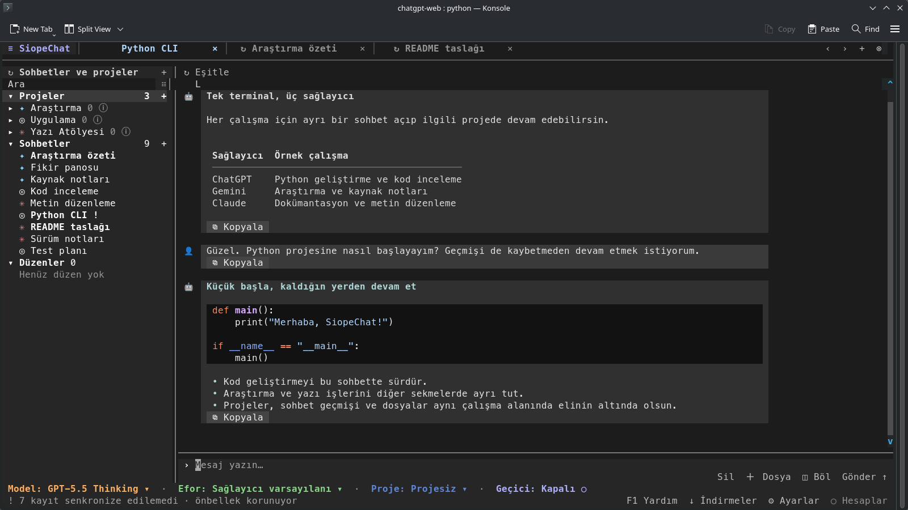

[![Sürüm: v1.5.6-beta][version-shield]](CHANGELOG.md)
[![Python 3.10+][python-shield]](https://www.python.org/downloads/)
[![GPL-3.0-only][license-shield]](LICENSE)

[English](README.md) | **Türkçe** | [Русский](README-RU.md)

# SiopeChat

**ChatGPT, Gemini, Claude ve Grok’un web sohbetleri tek terminalde.**

Sohbetlerinizi ve projelerinizi bir arada tutun. Yanıtları karşılaştırmak için sohbetleri yan yana açın.

> SiopeChat, web sohbetleri için bağımsız bir istemcidir. Tarayıcıdaki oturumunuzu kullanır, API anahtarı gerektirmez. Resmî geliştirici API’lerine bağlanmaz ve Codex, Claude Code ya da Google Antigravity CLI gibi kodlama ajanlarını çalıştırmaz. Hesabınızın model erişimi ve kullanım sınırları geçerlidir.

[Kurulum](#kurulum) · [Hesap bağlama](#hesap-bağlama) · [Sağlayıcıları karşılaştır](#sağlayıcı-özellikleri) · [Performans](#performans) · [Sürüm notları](CHANGELOG.md)



*Örnek sohbet verileriyle çalışan SiopeChat terminal arayüzü.*

## Kurulum

Git, Python 3.10 veya üzeri ve Unicode destekleyen bir terminal gerekir.

**Linux / macOS**

```sh
git clone https://github.com/TahsinCr/siopechat.git
cd siopechat
./install.sh
./siopechat.sh
```

**Windows (PowerShell)**

```powershell
git clone https://github.com/TahsinCr/siopechat.git
cd siopechat
.\install.ps1
.\siopechat.ps1
```

Kurulum betiğini bir kez çalıştırın. Sonraki açılışlarda yalnızca başlatıcıyı kullanın. Git üzerinden güncellemek için `git pull --ff-only` komutunun ardından işletim sisteminize uygun kurulum betiğini yeniden çalıştırın.

## Hesap bağlama

1. Varsayılan tarayıcınızda en son kullandığınız profilden sağlayıcı hesabınıza giriş yapın.
2. SiopeChat’te **Ayarlar → Hesaplar** bölümünden ilgili hesabı ekleyin veya seçin.
3. Oturumu içe aktarmak ve doğrulamak için **Profil ile doğrula** seçeneğini kullanın. Oturum sona ererse tarayıcıda yeniden giriş yapıp bu adımı tekrarlayın.

## Özellikler

- **Sekmeler ve bölünmüş görünüm.** Taslağınızı ve kaydırma konumunuzu kaybetmeden sohbetler arasında geçin. Dört sohbete kadar yan yana açabilir, bu düzeni çalışma alanı olarak kaydedebilirsiniz.
- **Hesaplar ve modeller.** Hesaplar arasında geçiş yapıp her birine sunulan modelleri seçin. Model destekliyorsa düşünme düzeyini ayarlayın.
- **Canlı yanıtlar.** Yanıtı geldikçe okuyun. Bir yanıt sürerken başka bir sekmeye geçebilirsiniz. Sağlayıcı destekliyorsa mesajı düzenleyin, yanıtı yeniden alın veya sohbeti dallandırın.
- **Projeler ve defterler.** ChatGPT ve Claude projeleriyle, Gemini defterleriyle veya Grok çalışma alanlarıyla çalışın. Sağlayıcının sunduğu talimat, kaynak ve sohbet taşıma seçeneklerini kullanın.
- **Geçmiş ve indirmeler.** Arşivdeki sohbetleri yeniden açın, konuşmaları düz metin veya JSON olarak dışa aktarın ve üretilen dosyaları indirme yöneticisinden takip edin.

## Sağlayıcı özellikleri

| SiopeChat’te | ChatGPT | Gemini | Claude | Grok |
| --- | --- | --- | --- | --- |
| Canlı yanıt, sohbet geçmişi ve model seçimi | Var | Var | Var | Var |
| Düşünme eforu seçimi | Desteklenen modellerde | Desteklenen modellerde | Desteklenen modellerde | — |
| Mesaj düzenleme ve yanıtı yeniden üretme | Var | Var | Var | Var |
| Sohbeti dallandırma | Var | Var | — | — |
| Geçici veya gizli sohbet | Var | Var | Proje dışında | Çalışma alanı dışında |
| Projeler | Projeler | Gemini defterleri | Projeler | Çalışma alanları |
| Proje talimatları, metin ve dosya kaynakları | Var | Var | Var | Var |
| Mevcut sohbeti projeye taşıma | Var | — | Var | Var |
| Sohbete dosya ekleme | Var | Var | Var | Var |

Tablo, sağlayıcıların SiopeChat üzerinden sunduğu işlevleri gösterir. Model erişimi, düzenlenebilen mesajlar ve dosya türleri sağlayıcıya, hesaba ve sohbete göre değişebilir. Çizgi, SiopeChat’te ilgili seçeneğin sunulmadığını belirtir.

## Performans

Kayıtlı bir sohbeti açtığınızda önce arşivdeki geçmiş görünür. Yeni mesajlar varsa arka planda alınır. Yanıt akmaya başladığında terminal ilk metni hemen çizer. Sonraki parçaları gruplar hâlinde işleyerek arayüzün akıcı kalmasını sağlar.

Bu akışın temelinde [WebAI Provider 2.0](https://pypi.org/project/webai-provider/2.0.0/) var. Motor, web oturumlarını yönetir. Kullanılabilir bağlantıları, güncel model listelerini ve sohbeti sürdürmek için gereken bilgileri yeniden kullanır. Siz mesajı yazarken SiopeChat, uygun sohbetlerde bir sonraki gönderimin hazırlığına başlayabilir. Böylece gönder tuşuna bastığınızda daha az hazırlık işi kalır. Modelin yanıt vermeye ne zaman başlayacağı sağlayıcıya ve ağ koşullarına bağlıdır.

## Sık kullanılan kısayollar

| Kısayol | İşlem |
| --- | --- |
| **Ctrl+P** | Komut paletini aç |
| **Ctrl+T / Ctrl+W** | Sekme aç veya kapat |
| **Alt+Sol / Alt+Sağ** | Sekmeler arasında geç |
| **Alt+J** | İndirmeleri aç |
| **F5 / F12** | Ayarları veya Hesapları aç |
| **F1** | Kısayol yardımını aç |

**Ayarlar → Genel → Dil** bölümünden İngilizce, Türkçe veya Rusça arayüzü seçebilirsiniz. Tuş atamalarını **Ayarlar → Kısayollar** bölümünden düzenleyebilirsiniz.

## Yerel veriler

SiopeChat, sohbet geçmişini ve kaynak bilgilerini yerel SQLite arşivinde tutar. Depo başlatıcıları varsayılan olarak taşınabilir modu kullanır ve verileri depo dizinine kaydeder. İşletim sisteminizin kullanıcı dizinlerini kullanmak için başlatmadan önce `SIOPECHAT_PORTABLE=0` ayarlayın. İndirme klasörünü ayarlardan seçebilirsiniz. Desteklenen geçici sohbetler yerel arşive kaydedilmez. Sağlayıcının saklama kuralları geçerlidir.

Eski bir sürümden geçiyorsanız arşivdeki `archive.sqlite3` dosyasını ve varsa `files/` dizinini yükseltmeden önce yedekleyin.

## Proje bağlantıları

[Sürüm notları](CHANGELOG.md) · [Hata bildirimleri](https://github.com/TahsinCr/siopechat/issues) · [WebAI Provider](https://github.com/TahsinCr/webai-provider/) · [GPL-3.0-only](LICENSE) · [Telif bildirimi](COPYRIGHT)

[version-shield]: https://img.shields.io/badge/version-v1.5.6--beta-b7a3e3.svg?style=for-the-badge
[python-shield]: https://img.shields.io/badge/Python-3.10%2B-3776AB.svg?style=for-the-badge&logo=python&logoColor=white
[license-shield]: https://img.shields.io/badge/license-GPL--3.0--only-blue.svg?style=for-the-badge
