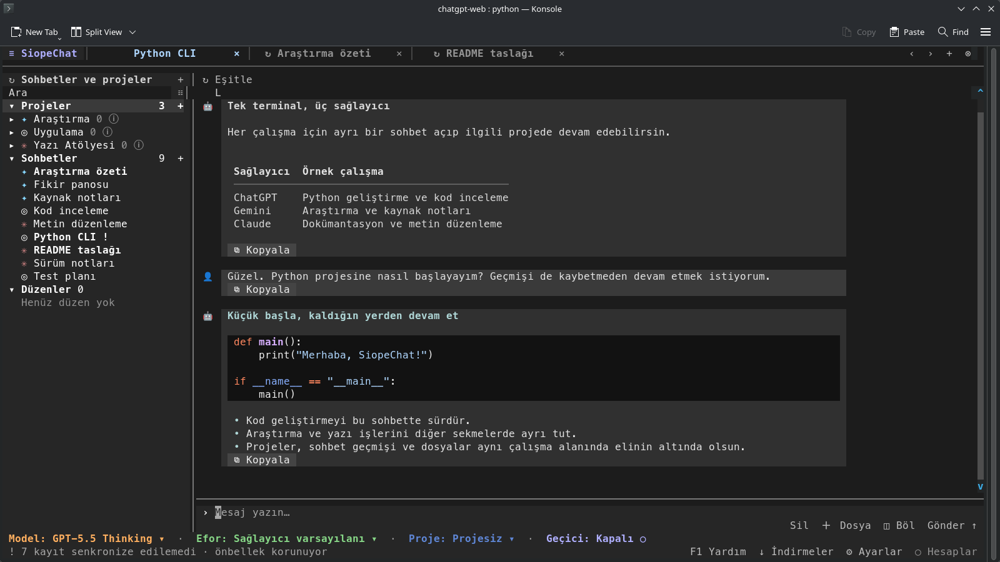

[![Version: v1.1-beta][version-shield]](CHANGELOG.md)
[![Python 3.10+][python-shield]](https://www.python.org/downloads/)
[![GPL-3.0-only][license-shield]](LICENSE)

**English** | [Türkçe](README-TR.md) | [Русский](README-RU.md)

# SiopeChat

SiopeChat brings ChatGPT, Gemini and Claude conversations into a terminal workspace. Keep several chats open, compare replies in split panes, and work with projects without switching between websites.

It uses your own signed-in web sessions. There are no API keys to configure, and your account's model access and usage limits still apply. This is an independent, unofficial client; changes to provider websites can affect individual features.



*An actual terminal capture with the Graphite theme and demonstration data.*

## What is included

- Tabs with separate drafts, scroll positions and reply indicators; up to four split panes per group.
- Account-scoped models and reasoning effort, with the last selection remembered for each account.
- ChatGPT and Claude projects, plus Gemini notebooks, with instructions and source management where supported.
- Search, account filters and date/name ordering shared by projects and chats.
- A SQLite archive that displays saved history first and synchronizes in the background.
- A command palette, configurable shortcuts, mouse controls, local extensions and JSON/Python themes.
- English, Turkish and Russian interface catalogs.

**v1.1-beta** continues the beta with improvements to account handling, provider files, synchronization and large conversations. Core workflows are covered by automated tests; provider compatibility and platform behavior still need feedback from daily use. The Python package version is `1.1b0`.

## Install and sign in

You need Python **3.10+** for ChatGPT and Claude, or **3.11+** for Gemini; Node.js **22+** for login helpers and the ChatGPT request signer; and Chrome/Chromium for the explicit sign-in step. Use a Unicode terminal. True color and mouse reporting are recommended.

Install from this checkout in your Python environment:

```sh
python -m pip install -e .
```

| Platform | Launcher |
| --- | --- |
| Linux / macOS terminal | `./siopechat.sh` |
| macOS Finder | `siopechat.command` |
| Windows Command Prompt | `siopechat.bat` |
| Windows PowerShell | `./siopechat.ps1` |
| Installed console command | `siopechat` |

Launchers reuse a `python/` environment in the checkout when present; they do not create one.

New installations start without any accounts. Add your first account under Settings → Accounts; SiopeChat does not create a ChatGPT account entry automatically.

Open **Settings → Accounts**, add or select an account and choose **Verify from profile**. You must already be signed in to the provider in your default browser’s last-used profile. SiopeChat imports and verifies that session without launching a browser. Chat, history, model and project operations then use HTTP. If the session expires, sign in again in your usual browser and repeat **Verify from profile**.

Add, edit and remove account buttons sit beneath the account list. Edit changes only the selected account’s display name; its login and history stay intact. Profile verification and logout share a separate row below the session details. Labels shorten in narrow terminals.

**Verify from profile** imports the selected provider’s signed-in session from the default browser’s last-used profile, without starting a browser or enabling debugging flags. Supported standard profile locations include Chrome, Chromium, Brave/Brave Origin, Edge, Vivaldi, Firefox and Zen. Only the selected provider’s authentication cookies are retained; Firefox uses the default container. The candidate session is checked with the provider before replacing a saved session. Your OS keyring may request access. Locked databases, custom/sandboxed profile locations and unsupported encryption (including some Windows Chromium configurations) can prevent import; the error is shown without deleting the saved session. Safari is not supported by this import option. Import errors distinguish missing reader dependencies, file permissions, database access, keyring access and decryption failures. Update dependencies using the same Python environment that launches SiopeChat. Session cookies in the current Firefox/Zen recovery snapshot are also supported; separate containers are excluded and old recovery snapshots are not combined. If the live cookie database is locked, the reader retries from a private copy including its WAL/journal; it does not modify your profile.

Firefox and Zen share a read-only cookie reader. Profile selection follows `profiles.ini` and `installs.ini`; ambiguous profiles are reported rather than merged. Linux discovery includes Firefox Snap/Flatpak locations and Zen’s current XDG, legacy and Flatpak locations.

You can add several accounts. One account per provider is selected for sending; browsing another account’s history does not silently change that selection. To verify a different account, first select its signed-in profile in your default browser, then use **Verify from profile** on the corresponding SiopeChat account.

Click an account row to select it; the arrow marks the account currently being managed. **Remove account** (Alt+Backspace while viewing accounts) asks for confirmation and removes the local account record, saved login and model preferences. It keeps the provider account and archived conversations. Tabs belonging to the removed account close, obsolete filters are cleared, and another enabled account is selected. Add a replacement before removing the last enabled account.

## Everyday use

Write in the composer and press **Enter** to send. **Shift+Enter** inserts a newline on terminals with extended keyboard reporting, which SiopeChat requests while active. If your terminal sends the same code for Enter and Shift+Enter, use **Alt+Enter** or **Ctrl+J**. The composer grows to its configured height, then scrolls. Ctrl+A selects text, Ctrl+C copies a selection, and Ctrl+V pastes. Click a message to select and copy its contents.

A new chat offers models from the selected accounts of enabled providers. An existing chat stays with its original account. Model and effort choices come from provider catalogs; unavailable or upgrade-only entries are filtered when that information is available. A listed model can still be refused by the server. Provider-published thinking summaries appear separately from answers; private reasoning is not available.

Click a Markdown web link in a message to open it in your default browser. Clicking elsewhere in the message still selects it for copying.

File links download in the background to `downloads/` under the project directory. Change this in **Settings → General → Download folder**; relative paths are resolved against the project and absolute paths are supported. At most two transfers run at once, progress appears in the status bar, existing files are preserved and failed transfers are cleaned up. Ordinary web pages still open in your default browser. ChatGPT sandbox files are resolved through the owning conversation; Gemini image placeholders use actual provider media records, and Claude sandbox/computer links use the owning conversation’s file store. Protected downloads use the selected account’s saved session; account credentials are not forwarded to other origins. Missing or expired resources show an error instead of a fabricated URL.

Drag across a response or thinking summary to select part of its rendered text, then press Ctrl+C. Click a message and press Ctrl+A to select the whole message.

Closing a conversation tab keeps its running response in the background. In the sidebar, a green **●** marks a running conversation and **✓** marks a completed background reply. Select it to reopen the same conversation. You can open other conversations and synchronize history while a response is running. This continues only while SiopeChat is running.

| Default shortcut | Action |
| --- | --- |
| F1 | Open or close help |
| Ctrl+P | Command palette |
| Ctrl+T / Ctrl+W | New tab / close tab |
| Alt+Left / Alt+Right | Previous / next tab |
| Alt+[ / Alt+] | Previous / next pane in the split group |
| Alt+W | Close all idle tabs |
| F7 | Toggle sidebar |
| F8 / F10 | Synchronize conversation / library |
| F5 / F12 | Settings / accounts |

Shortcut changes take effect immediately throughout the interface. Every binding is editable under **Settings → Keyboard** and in the local `config.json`. The command palette exposes the same actions, including extension actions.

Settings is a regular workspace tab: switch back to a conversation with Alt+Left/Right, reopen the same Settings tab with F5, or close it with Ctrl+W.

### Projects and split views

Use `/project` to choose a project for a new chat or move the current chat where supported. Choose **Unassigned** to remove membership. `/project-new` asks for the provider/account and then its supported creation fields. Project details provide name/instruction editing and source controls; Ctrl+S saves the inline editor.

You can also write directly from project details. Choose a model and effort for that project's account and send: a separate conversation tab opens inside the project. The composer and selectors are hidden while editing the project itself.

Choose **Split**, `/split` or `/split-down`, then select another chat from the sidebar. Click anywhere in an inactive pane to activate it. Scrolling a passive pane does not change focus. `/unsplit` returns to one pane. Saved workspace metadata is supported; saving and restoring the live split arrangement is not included yet.

Use **Delete** beside the composer to delete a conversation. `/project-delete` opens a project picker; project details also have a delete button. Both ask for permanent-deletion confirmation, with **No** focused initially. Deletion is submitted to the provider and checked there before removing local records. Project deletion follows the provider's rules for its contained chats. Closing tabs does not delete conversations.

### Provider differences

| Provider | Project support | Current limits |
| --- | --- | --- |
| ChatGPT | Projects, instructions, sources and supported chat moves | Models, effort, temporary mode and project options depend on the account. |
| Gemini | Gemini notebooks shown as a distinct project type; notebook-context chats, instructions and text sources | Existing chats cannot be moved into notebooks. File/URL source import is not exposed. Native effort choices depend on the transport. |
| Claude | Projects, instructions, text/file sources and supported membership changes | Chat attachments, temporary chats and privacy/memory overrides beyond private/default are not exposed. |

Gemini notebooks use the Gemini account session; a separate NotebookLM login is not required. Container types and native metadata remain distinct internally. SiopeChat does not pretend that every provider has the same capabilities.

Attachments are limited locally to **20 MiB** per file; providers may have stricter limits. Temporary mode is offered only when supported and does not save conversation snapshots locally. Provider retention rules still apply.

## Configuration and local data

`config.json` is created locally and excluded from Git. Defaults are defined in `src/settings.py`. Choose a language under **Settings → General → Language** (`en`, `tr`, `ru`), enable providers under **Providers**, and manage feature packages under **Extensions**. At least one provider must remain enabled.

Set `SIOPECHAT_HOME` to use a different configuration/data directory. Keep configuration, account sessions and `data/` private; do not attach them to bug reports.

The archive extension stores conversations, ordered messages, published thinking, projects/notebooks, memberships and resource metadata in `data/archive.sqlite3`. File content belongs in `data/files/`, with hashes and locations recorded in the database. Existing local attachments are copied after a successful normal send. Remote images and sources are retained as references; not every remote file is downloaded automatically.

Previously loaded conversations open from the local archive and refresh in the background. Synchronization indicators appear in the footer and conversation list. Refreshes reconcile newer local turns instead of replacing an active reply. Failed refreshes retain the last good data. Remote mutations are not automatically replayed after an ambiguous failure: synchronize before resending.

The archive has bounded memory and worker queues. Large transcript preparation runs outside the UI event loop. The sidebar draws visible rows on demand and reuses its filtered, sorted list until library data changes. Disabling the archive preserves its files and leaves direct provider loading and sending available. Disabling layout removes split controls without disabling providers.

## Extensions

Add `extensions/my_feature/plugin.py`. Export an `ExtensionSpec` whose activation function registers contributions through the shared API:

```python
from extension import Action, ExtensionSpec, SettingField


def activate(context):
    context.settings(SettingField("enabled", bool, True, "my_feature.enabled"))
    context.translations("en", {"enabled": "Enable my feature"})
    context.translations("tr", {"enabled": "Özelliğimi etkinleştir"})
    context.translations("ru", {"enabled": "Включить расширение"})
    context.action(Action("my_feature.hello", "Hello", lambda: "Hello"))


SPEC = ExtensionSpec("my_feature", activate)
```

Restart to discover the package, then enable or disable it in **Settings → Extensions**. Settings live under `extensions.my_feature`; contributed language bundles are namespaced and merged with the application catalog. Declare dependencies with `requires=("archive",)` when needed. Actions can declare input fields for the command palette; extensions can also contribute services, views and themes.

For archive access, use `context.api.get("archive")`. Its `conversations`, `messages` and `resources` methods provide paginated records scoped by provider/account. The replaceable repository contract and SQLite adapter live in `extensions/archive/repository.py`; provider normalization lives in `adapters.py`.

Extensions and Python themes execute local code. Load only packages you trust. Keep network work out of render functions and use the shared lifecycle for cleanup.

## Themes

Place a JSON theme in `themes/` and select its `id` under **Settings → General → Theme**:

```json
{
  "id": "my-theme",
  "tokens": {"background": "#202020", "foreground": "#dedede", "accent": "#b7a3e3"},
  "styles": {"tab.active": "bold #b7a3e3"},
  "options": {"sidebar_width": 28, "message_width": 100, "composer_max_lines": 6, "tab_width": 26}
}
```

Missing values inherit the defaults. Colors use six-digit hexadecimal notation; terminal styles use Prompt Toolkit syntax and `markdown` styles use Rich syntax. Supported option ranges are 16–40 cells for the sidebar, 40–160 for message width, 3–16 composer lines and 12–40 cells per tab.

For computed themes, export the same dictionary as `THEME` from a Python file. [Graphite](themes/graphite.py) is an example. Extensions can register themes through `context.theme(...)`. Invalid optional themes are reported without preventing the default theme from loading.

## Development

Application settings and cached records share atomic JSON persistence. The independent provider library owns session persistence and common project-source validation; it does not depend on application utilities.

Bundled providers use their HTTPS transports for conversations and projects. Packaged Node helpers are limited to explicit login/session capture and ChatGPT request signing.

The provider library is independent of the terminal, archive and application runtime. `accounts.py` routes provider/account work; `runtime.py`, `actions.py` and `extension.py` manage shared services and contributions. Terminal-specific code stays in `src/cli/`, with tab rendering in `layout.py` and library filtering/rows in `library.py`. Optional features live in `extensions/`, common helpers in `src/utils/`. A GUI can consume the same services; no GUI is included in this beta.

Tests run without requiring your personal account sessions:

```sh
PYTHONPATH=src:. python -m unittest discover -s tests
node --test tests/js/*.test.cjs
uvx ruff check src extensions tests
uvx ruff format --check src extensions tests
uv build
```

Before reporting an issue, note the provider, operation, terminal, operating system and error message. Remove credentials and private conversation content. The [changelog](CHANGELOG.md) records release changes.

## License

Copyright © TahsinCr. Licensed under [GPL-3.0-only](LICENSE). Vendored components retain their own notices in `src/utils/`.

[version-shield]: https://img.shields.io/badge/version-v1.1--beta-b7a3e3.svg?style=for-the-badge
[python-shield]: https://img.shields.io/badge/Python-3.10%2B-3776AB.svg?style=for-the-badge&logo=python&logoColor=white
[license-shield]: https://img.shields.io/badge/license-GPL--3.0--only-blue.svg?style=for-the-badge
